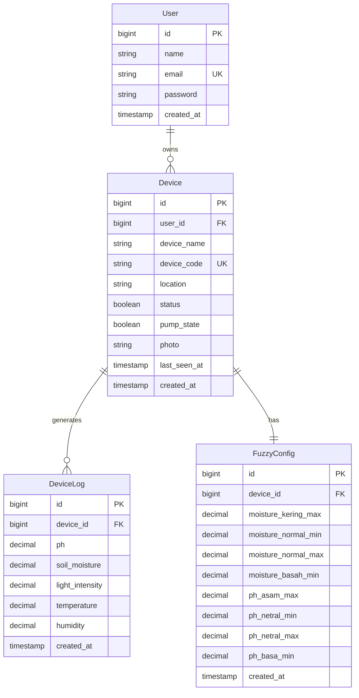
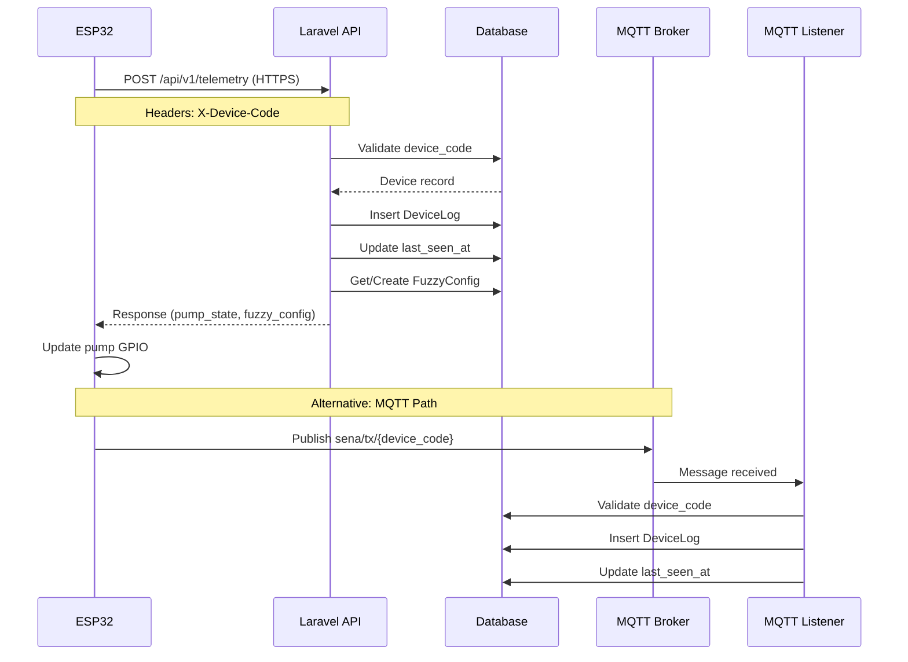
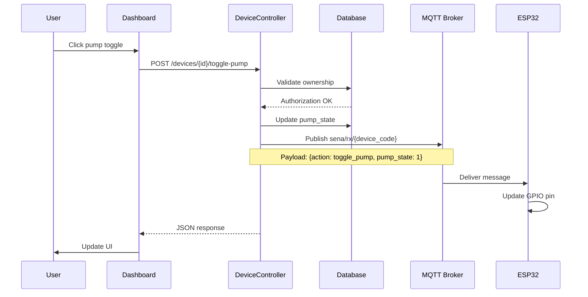
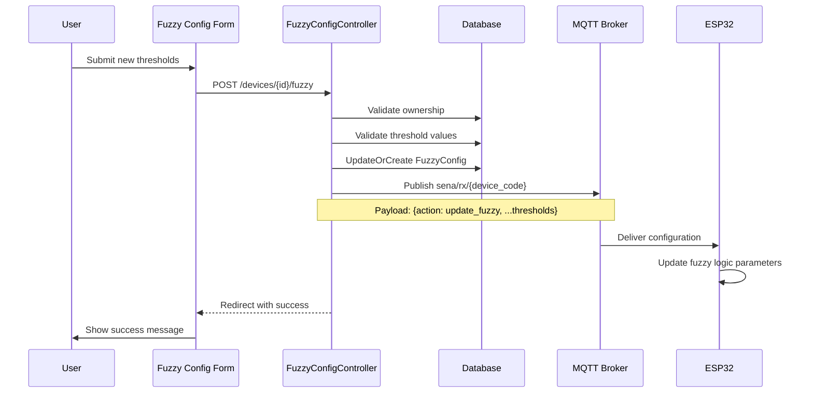
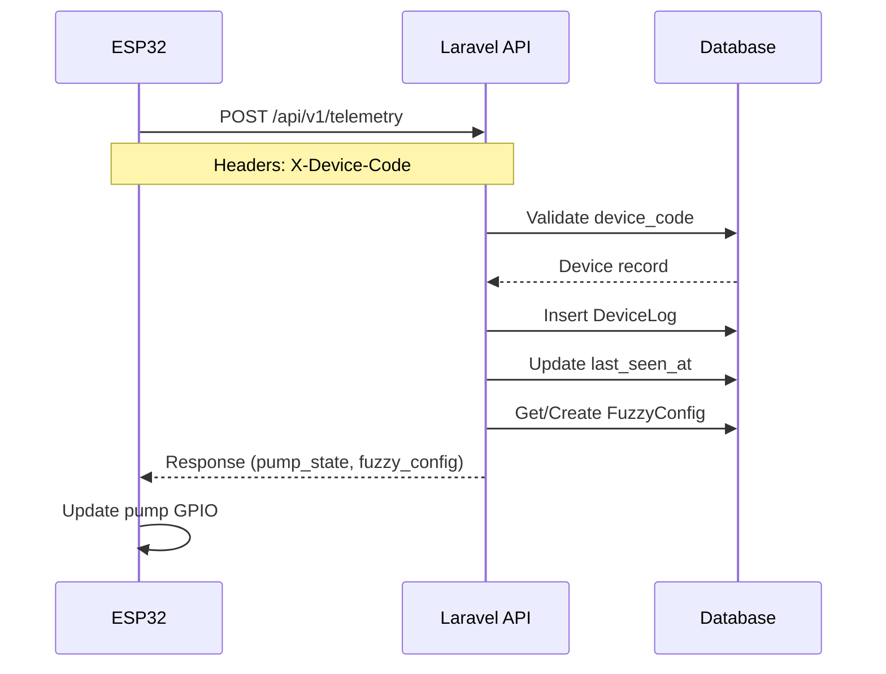

# Technical Design Document

## Overview

This design document specifies the architecture and implementation approach for generating comprehensive documentation for the Smart Farming IoT System. The system is a Laravel-based web application that integrates with ESP32 IoT devices for real-time agricultural monitoring and automated control using fuzzy logic.

### Purpose

The documentation system will produce:
- **UML Diagrams**: Use case, sequence, class, and activity diagrams showing system structure and behavior
- **Architecture Documentation**: Detailed specifications of MQTT communication, ESP32 firmware, and server APIs
- **Feature Documentation**: Comprehensive descriptions of dashboard, device management, fuzzy logic, and logging features
- **Code Logic Explanations**: In-depth explanations of controllers, models, and firmware implementation

### Scope

The documentation covers:
- Laravel backend with Sanctum authentication
- ESP32 IoT devices with WiFi and HTTPS communication
- MQTT broker for real-time messaging (publish-subscribe pattern)
- Fuzzy logic control system for automated irrigation
- Real-time dashboard with telemetry monitoring
- Device management and logging features

### Target Audience

- System architects and technical leads
- Backend and frontend developers
- Embedded systems developers working with ESP32
- DevOps engineers managing deployment
- Product managers and business analysts
- Technical documentation maintainers


## Architecture

### System Architecture Overview

The Smart Farming IoT System follows a three-tier architecture:

```
┌─────────────────┐         ┌──────────────────┐         ┌─────────────────┐
│   ESP32 Devices │◄───────►│  Laravel Server  │◄───────►│   Web Dashboard │
│   (Firmware)    │  HTTPS  │   (Backend API)  │  HTTP   │   (Frontend)    │
└─────────────────┘         └──────────────────┘         └─────────────────┘
        │                            │
        │                            │
        └────────────MQTT────────────┘
                     │
              ┌──────▼──────┐
              │ MQTT Broker │
              └─────────────┘
```

**Layer 1: IoT Device Layer (ESP32)**
- Sensor data collection (pH, soil moisture, light, temperature, humidity)
- WiFi connectivity management
- HTTPS API communication for telemetry transmission
- MQTT subscription for receiving control commands
- Actuator control (pump relay)

**Layer 2: Application Layer (Laravel)**
- RESTful API endpoints for device communication
- MQTT listener for real-time telemetry processing
- Database persistence (SQLite/MySQL)
- Authentication and authorization (Sanctum)
- Business logic and fuzzy logic configuration management

**Layer 3: Presentation Layer (Web Dashboard)**
- Real-time telemetry visualization
- Device management interface
- Fuzzy logic configuration UI
- Historical data charts and export


### Communication Architecture

#### MQTT Communication Pattern

**Broker Configuration:**
- Host: Configurable via `config/mqtt.php`
- Port: 1883 (standard) or 8883 (TLS)
- Authentication: Username/password (optional)
- Client ID: Unique identifier per connection

**Topic Structure:**
```
sena/tx/{device_code}  → Device publishes telemetry data
sena/rx/{device_code}  → Device subscribes for control commands
```

**Message Flow:**

1. **Telemetry Publishing (Device → Server)**
   - Topic: `sena/tx/{device_code}`
   - QoS: 0 (at most once delivery)
   - Payload: JSON with sensor readings
   - Frequency: Every 5 seconds (configurable)

2. **Control Commands (Server → Device)**
   - Topic: `sena/rx/{device_code}`
   - QoS: 0 (at most once delivery)
   - Payload: JSON with action and parameters
   - Trigger: User action or automated rule

#### HTTPS API Communication

**ESP32 → Laravel API:**
- Endpoint: `POST /api/v1/telemetry`
- Protocol: HTTPS with SSL/TLS
- Authentication: Custom header `X-Device-Code: {uuid}`
- Content-Type: `application/json`
- Response: Device controls and fuzzy configuration

**Request Payload:**
```json
{
  "ph": 6.5,
  "soil_moisture": 65.0,
  "light_intensity": 850.0,
  "temperature": 26.5,
  "humidity": 72.0
}
```

**Response Payload:**
```json
{
  "status": "success",
  "message": "Telemetry data saved correctly",
  "data": { /* DeviceLog resource */ },
  "device_controls": {
    "pump_state": true
  },
  "fuzzy_config": {
    "moisture_kering_max": 30.0,
    "moisture_normal_min": 30.0,
    "moisture_normal_max": 70.0,
    "moisture_basah_min": 70.0,
    "ph_asam_max": 6.0,
    "ph_netral_min": 6.0,
    "ph_netral_max": 8.0,
    "ph_basa_min": 8.0
  }
}
```


## Components and Interfaces

### Documentation Generation Components

#### 1. UML Diagram Generator

**Responsibility:** Generate all UML diagrams from codebase analysis

**Inputs:**
- Laravel application source code (controllers, models, routes)
- ESP32 firmware source code
- Database schema (migrations)
- Configuration files

**Outputs:**
- Use case diagrams (PlantUML or Mermaid format)
- Sequence diagrams for key workflows
- Class diagrams for models and controllers
- Activity diagrams for business processes

**Technology Stack:**
- PlantUML or Mermaid.js for diagram generation
- PHP reflection API for code analysis
- Laravel route introspection

**Interface:**
```php
interface UMLDiagramGenerator
{
    public function generateUseCaseDiagram(): string;
    public function generateSequenceDiagram(string $workflow): string;
    public function generateClassDiagram(string $namespace): string;
    public function generateActivityDiagram(string $process): string;
}
```

#### 2. Architecture Documenter

**Responsibility:** Document communication patterns and system architecture

**Inputs:**
- MQTT configuration (`config/mqtt.php`)
- API routes (`routes/api.php`, `routes/web.php`)
- ESP32 firmware communication code
- Controller implementations

**Outputs:**
- MQTT topic documentation with examples
- API endpoint specifications (OpenAPI/Swagger format)
- Communication sequence descriptions
- Security and authentication documentation

**Interface:**
```php
interface ArchitectureDocumenter
{
    public function documentMQTTArchitecture(): array;
    public function documentAPIEndpoints(): array;
    public function documentESP32Communication(): array;
    public function documentSecurityMechanisms(): array;
}
```


#### 3. Feature Documenter

**Responsibility:** Document user-facing features and workflows

**Inputs:**
- View templates (Blade files)
- Controller methods
- JavaScript frontend code
- User stories from requirements

**Outputs:**
- Feature descriptions with screenshots
- User workflow documentation
- Permission and access control documentation
- UI component documentation

**Interface:**
```php
interface FeatureDocumenter
{
    public function documentDashboardFeature(): array;
    public function documentDeviceManagement(): array;
    public function documentFuzzyLogicConfiguration(): array;
    public function documentLoggingSystem(): array;
}
```

#### 4. Code Logic Explainer

**Responsibility:** Generate detailed code explanations with inline comments

**Inputs:**
- Controller source files
- Model source files
- ESP32 firmware source
- Command classes

**Outputs:**
- Annotated code snippets
- Method-by-method explanations
- Data flow descriptions
- Error handling documentation

**Interface:**
```php
interface CodeLogicExplainer
{
    public function explainController(string $controllerClass): array;
    public function explainModel(string $modelClass): array;
    public function explainFirmwareLogic(string $firmwareFile): array;
    public function explainCommand(string $commandClass): array;
}
```


### Laravel Application Components

#### Models

**Device Model** (`app/Models/Device.php`)
- Attributes: `id`, `user_id`, `device_name`, `device_code`, `location`, `status`, `pump_state`, `photo`, `last_seen_at`
- Relationships: `belongsTo(User)`, `hasMany(DeviceLog)`, `hasOne(FuzzyConfig)`
- Accessors: `getPhotoUrlAttribute()`, `getIsOnlineAttribute()`
- Casts: `status` (boolean), `pump_state` (boolean), `last_seen_at` (datetime)

**DeviceLog Model** (`app/Models/DeviceLog.php`)
- Attributes: `id`, `device_id`, `ph`, `soil_moisture`, `light_intensity`, `temperature`, `humidity`, `created_at`
- Relationships: `belongsTo(Device)`
- Purpose: Store historical telemetry data

**FuzzyConfig Model** (`app/Models/FuzzyConfig.php`)
- Attributes: `id`, `device_id`, `moisture_kering_max`, `moisture_normal_min`, `moisture_normal_max`, `moisture_basah_min`, `ph_asam_max`, `ph_netral_min`, `ph_netral_max`, `ph_basa_min`
- Relationships: `belongsTo(Device)`
- Purpose: Store fuzzy logic thresholds per device

**User Model** (`app/Models/User.php`)
- Attributes: `id`, `name`, `email`, `password`, `email_verified_at`
- Relationships: `hasMany(Device)`
- Authentication: Laravel Sanctum for API tokens

#### Controllers

**DeviceController** (`app/Http/Controllers/DeviceController.php`)
- `index()`: List user's devices with pagination
- `create()`: Show device creation form
- `store()`: Create new device with UUID generation and photo upload
- `edit()`: Show device edit form with ownership validation
- `update()`: Update device with photo management
- `destroy()`: Delete device and associated photo
- `togglePump()`: Toggle pump state and publish MQTT command

**TelemetryController** (`app/Http/Controllers/Api/TelemetryController.php`)
- `store()`: Receive telemetry from ESP32, validate device, save data, return controls and fuzzy config

**DashboardController** (`app/Http/Controllers/DashboardController.php`)
- `index()`: Display dashboard with device selection and recent logs
- `data()`: Return JSON data for AJAX polling (latest readings and chart data)

**FuzzyConfigController** (`app/Http/Controllers/FuzzyConfigController.php`)
- `edit()`: Show fuzzy configuration form
- `update()`: Update fuzzy config and publish to device via MQTT


### ESP32 Firmware Components

**Main Components:**

1. **WiFi Manager**
   - Establishes WiFi connection on startup
   - Monitors connection status
   - Handles reconnection logic

2. **Sensor Data Simulator**
   - Generates randomized sensor readings for testing
   - Ranges: pH (5.0-7.0), moisture (40-90%), light (300-1200), temp (23-27°C), humidity (50-80%)
   - Production: Replace with actual sensor reading code

3. **HTTPS Client**
   - Initializes secure connection with `WiFiClientSecure`
   - Uses `setInsecure()` for testing (should use CA certificate in production)
   - Constructs POST requests with JSON payload
   - Adds authentication header `X-Device-Code`

4. **JSON Serializer/Deserializer**
   - Uses ArduinoJson library
   - Serializes sensor data to JSON for transmission
   - Deserializes server response to extract pump commands

5. **Pump Controller**
   - Controls GPIO pin (default: pin 2)
   - Responds to `pump_state` from server response
   - Can control relay module for actual pump

6. **Timing Controller**
   - Non-blocking delay using `millis()`
   - Configurable interval (default: 5000ms)
   - Prevents blocking main loop


## Data Models

### Database Schema

#### users table
```sql
- id: bigint (PK, auto-increment)
- name: varchar(255)
- email: varchar(255) UNIQUE
- email_verified_at: timestamp NULL
- password: varchar(255)
- remember_token: varchar(100) NULL
- created_at: timestamp
- updated_at: timestamp
```

#### devices table
```sql
- id: bigint (PK, auto-increment)
- user_id: bigint (FK → users.id)
- device_name: varchar(255)
- device_code: varchar(255) UNIQUE (UUID)
- location: varchar(255) NULL
- status: boolean DEFAULT true
- pump_state: boolean DEFAULT false
- photo: varchar(255) NULL
- last_seen_at: timestamp NULL
- created_at: timestamp
- updated_at: timestamp
```

#### device_logs table
```sql
- id: bigint (PK, auto-increment)
- device_id: bigint (FK → devices.id)
- ph: decimal(4,2) NULL
- soil_moisture: decimal(5,2) NULL
- light_intensity: decimal(8,2) NULL
- temperature: decimal(5,2) NULL
- humidity: decimal(5,2) NULL
- created_at: timestamp
- updated_at: timestamp
```

#### fuzzy_configs table
```sql
- id: bigint (PK, auto-increment)
- device_id: bigint (FK → devices.id, UNIQUE)
- moisture_kering_max: decimal(5,2) DEFAULT 30.00
- moisture_normal_min: decimal(5,2) DEFAULT 30.00
- moisture_normal_max: decimal(5,2) DEFAULT 70.00
- moisture_basah_min: decimal(5,2) DEFAULT 70.00
- ph_asam_max: decimal(4,2) DEFAULT 6.00
- ph_netral_min: decimal(4,2) DEFAULT 6.00
- ph_netral_max: decimal(4,2) DEFAULT 8.00
- ph_basa_min: decimal(4,2) DEFAULT 8.00
- created_at: timestamp
- updated_at: timestamp
```

#### personal_access_tokens table (Laravel Sanctum)
```sql
- id: bigint (PK, auto-increment)
- tokenable_type: varchar(255)
- tokenable_id: bigint
- name: varchar(255)
- token: varchar(64) UNIQUE
- abilities: text NULL
- last_used_at: timestamp NULL
- expires_at: timestamp NULL
- created_at: timestamp
- updated_at: timestamp
```


### Entity Relationships



### Data Flow Diagrams

#### Telemetry Data Flow




#### Pump Control Flow



#### Fuzzy Configuration Update Flow




## Error Handling

### API Error Responses

**Authentication Errors:**
```json
{
  "status": "error",
  "message": "Unauthorized: Device Code missing"
}
```
HTTP Status: 401

**Authorization Errors:**
```json
{
  "status": "error",
  "message": "Unauthorized: Invalid or inactive device"
}
```
HTTP Status: 403

**Validation Errors:**
```json
{
  "message": "The given data was invalid.",
  "errors": {
    "ph": ["The ph must be between 0 and 14."],
    "soil_moisture": ["The soil moisture must be between 0 and 100."]
  }
}
```
HTTP Status: 422

**Server Errors:**
```json
{
  "status": "error",
  "message": "Internal Server Error"
}
```
HTTP Status: 500

### ESP32 Error Handling

**WiFi Connection Failures:**
- Retry connection every 500ms
- Display connection status via Serial monitor
- Continue attempting until successful

**HTTPS Request Failures:**
- Log HTTP response code to Serial
- Continue operation (next attempt in 5 seconds)
- No data loss (stateless operation)

**JSON Parsing Errors:**
- Check `DeserializationError` from ArduinoJson
- Log error to Serial
- Skip pump state update if parsing fails
- Continue normal operation

### MQTT Error Handling

**Connection Failures:**
- Log error via Laravel Log facade
- Display error in console (MqttListener command)
- Attempt reconnection based on keep-alive settings

**Message Processing Errors:**
- Validate JSON payload before processing
- Log invalid messages
- Skip processing for invalid device codes
- Continue listening for next message

### Database Error Handling

**Constraint Violations:**
- Catch unique constraint violations (duplicate device_code)
- Return validation error to user
- Rollback transaction if applicable

**Foreign Key Violations:**
- Validate relationships before deletion
- Cascade delete for dependent records (device_logs)
- Prevent orphaned records


## Correctness Properties

**Note: Property-based testing is not applicable to this documentation generation feature. No testable properties are defined.**

### Why Property-Based Testing Does Not Apply

This documentation generation system does not have universal properties suitable for property-based testing because:

1. **Not Executable Logic**: The system generates static documentation content (markdown, diagrams, explanations) rather than executing runtime logic with verifiable behavior.

2. **Human-Readable Output**: Outputs are intended for human consumption and cannot be validated with "for all X, property P(X) holds" statements.

3. **Subjective Quality**: Documentation quality (clarity, completeness, usefulness) is subjective and context-dependent, not universally quantifiable.

4. **Static Analysis**: The system analyzes existing code structure rather than processing variable inputs with consistent behavior.

### Alternative Testing Strategy

Instead of property-based testing, this feature uses:

- **Completeness Tests**: Verify all code components (controllers, models, routes) are documented
- **Accuracy Tests**: Verify examples match actual system behavior (API responses, database schema)
- **Format Validation**: Verify output format correctness (valid markdown, valid JSON, valid diagrams)
- **Integration Tests**: Verify generated examples execute correctly

See the Testing Strategy section below for detailed test specifications.

## Testing Strategy

### Why Property-Based Testing Does Not Apply

Property-based testing (PBT) is **not applicable** to this documentation generation feature because:

1. **No Pure Functions with Universal Properties**: Documentation generation is not a pure function with clear input/output behavior that can be tested across a wide input space. It's a content generation and formatting process.

2. **Output is Human-Readable Content**: The primary output is markdown documentation, UML diagrams, and explanatory text intended for human consumption, not machine-verifiable correctness properties.

3. **Subjective Quality Criteria**: Documentation quality involves subjective factors like clarity, completeness, and usefulness that cannot be expressed as universal properties.

4. **Static Analysis and Generation**: The system performs static code analysis and content generation, which is better validated through:
   - Completeness checks (all components documented)
   - Accuracy checks (examples match actual behavior)
   - Format validation (valid markdown, valid diagrams)
   - Integration tests (API examples work correctly)

**Appropriate Testing Approach**: Instead of PBT, this feature requires:
- **Completeness tests**: Verify all code components are documented
- **Accuracy tests**: Verify examples match actual system behavior
- **Format validation tests**: Verify output format is correct
- **Integration tests**: Verify generated examples execute correctly

### Documentation Testing Approach

The testing strategy focuses on:

#### 1. Documentation Completeness Tests

**Unit Tests:**
- Verify all controllers are documented
- Verify all models are documented
- Verify all API endpoints are documented
- Verify all MQTT topics are documented
- Verify all UML diagrams are generated

**Example Test Cases:**
```php
public function test_all_controllers_are_documented()
{
    $controllers = $this->getControllerList();
    $documentedControllers = $this->getDocumentedControllers();
    
    $this->assertEquals(
        count($controllers),
        count($documentedControllers),
        'Not all controllers are documented'
    );
}

public function test_all_api_endpoints_have_examples()
{
    $endpoints = Route::getRoutes()->match(Request::create('/api/*'));
    
    foreach ($endpoints as $endpoint) {
        $this->assertDocumentationHasExample($endpoint);
    }
}
```

#### 2. Documentation Accuracy Tests

**Integration Tests:**
- Verify UML diagrams match actual code structure
- Verify API examples produce expected responses
- Verify MQTT message examples are valid JSON
- Verify code snippets compile/execute correctly

**Example Test Cases:**
```php
public function test_telemetry_api_example_matches_actual_response()
{
    $device = Device::factory()->create();
    
    $response = $this->postJson('/api/v1/telemetry', [
        'ph' => 6.5,
        'soil_moisture' => 65.0,
        'light_intensity' => 850.0,
        'temperature' => 26.5,
        'humidity' => 72.0
    ], [
        'X-Device-Code' => $device->device_code
    ]);
    
    $documentedExample = $this->getDocumentedAPIExample('telemetry.store');
    
    $response->assertJsonStructure($documentedExample['response_structure']);
}
```


#### 3. Documentation Format Tests

**Unit Tests:**
- Verify markdown syntax is valid
- Verify code blocks have language tags
- Verify internal links are not broken
- Verify diagrams render correctly
- Verify table of contents is complete

**Example Test Cases:**
```php
public function test_all_code_blocks_have_language_tags()
{
    $documentation = $this->getGeneratedDocumentation();
    $codeBlocks = $this->extractCodeBlocks($documentation);
    
    foreach ($codeBlocks as $block) {
        $this->assertNotEmpty(
            $block['language'],
            'Code block missing language tag'
        );
    }
}

public function test_all_internal_links_are_valid()
{
    $documentation = $this->getGeneratedDocumentation();
    $links = $this->extractInternalLinks($documentation);
    $sections = $this->extractSectionIds($documentation);
    
    foreach ($links as $link) {
        $this->assertContains(
            $link['target'],
            $sections,
            "Broken link: {$link['target']}"
        );
    }
}
```

#### 4. UML Diagram Validation Tests

**Integration Tests:**
- Verify use case diagrams include all actors
- Verify sequence diagrams show correct message flow
- Verify class diagrams match model relationships
- Verify activity diagrams include all decision points

**Example Test Cases:**
```php
public function test_class_diagram_matches_eloquent_relationships()
{
    $classDiagram = $this->generateClassDiagram();
    
    // Verify User -> Device relationship
    $this->assertDiagramContainsRelationship(
        $classDiagram,
        'User',
        'Device',
        'one-to-many'
    );
    
    // Verify Device -> DeviceLog relationship
    $this->assertDiagramContainsRelationship(
        $classDiagram,
        'Device',
        'DeviceLog',
        'one-to-many'
    );
    
    // Verify Device -> FuzzyConfig relationship
    $this->assertDiagramContainsRelationship(
        $classDiagram,
        'Device',
        'FuzzyConfig',
        'one-to-one'
    );
}
```


#### 5. Code Example Validation Tests

**Unit Tests:**
- Verify PHP code examples are syntactically valid
- Verify C++ firmware examples compile
- Verify JSON examples are valid JSON
- Verify SQL examples are valid SQL

**Example Test Cases:**
```php
public function test_all_php_code_examples_are_valid()
{
    $documentation = $this->getGeneratedDocumentation();
    $phpExamples = $this->extractCodeExamples($documentation, 'php');
    
    foreach ($phpExamples as $example) {
        $result = $this->validatePHPSyntax($example['code']);
        $this->assertTrue(
            $result['valid'],
            "Invalid PHP syntax: {$result['error']}"
        );
    }
}

public function test_all_json_examples_are_valid()
{
    $documentation = $this->getGeneratedDocumentation();
    $jsonExamples = $this->extractCodeExamples($documentation, 'json');
    
    foreach ($jsonExamples as $example) {
        $decoded = json_decode($example['code']);
        $this->assertNotNull(
            $decoded,
            "Invalid JSON: " . json_last_error_msg()
        );
    }
}
```

#### 6. Documentation Maintenance Tests

**Regression Tests:**
- Verify documentation updates when code changes
- Verify version numbers are incremented
- Verify changelog is updated
- Verify deprecated features are marked

**Example Test Cases:**
```php
public function test_documentation_version_matches_app_version()
{
    $appVersion = config('app.version');
    $docVersion = $this->getDocumentationVersion();
    
    $this->assertEquals(
        $appVersion,
        $docVersion,
        'Documentation version does not match application version'
    );
}

public function test_all_deprecated_methods_are_marked_in_docs()
{
    $deprecatedMethods = $this->getDeprecatedMethods();
    $documentedDeprecations = $this->getDocumentedDeprecations();
    
    foreach ($deprecatedMethods as $method) {
        $this->assertContains(
            $method,
            $documentedDeprecations,
            "Deprecated method not documented: {$method}"
        );
    }
}
```

### Test Coverage Goals

- **Documentation Completeness:** 100% of controllers, models, and routes documented
- **Example Accuracy:** 100% of API examples produce expected responses
- **Format Validation:** 100% of code blocks have language tags
- **Link Validation:** 0 broken internal links
- **Diagram Accuracy:** 100% of relationships match actual code


## Documentation Generation Workflow

### Phase 1: Code Analysis and Extraction

**Step 1.1: Analyze Laravel Application Structure**
- Scan `app/Http/Controllers` for all controller classes
- Scan `app/Models` for all Eloquent models
- Parse `routes/web.php` and `routes/api.php` for endpoint definitions
- Extract database schema from migration files
- Identify relationships using PHP Reflection API

**Step 1.2: Analyze ESP32 Firmware**
- Parse `esp32_firmware.ino` for main functions
- Extract WiFi configuration patterns
- Identify HTTPS communication logic
- Document sensor reading and actuator control code
- Extract timing and loop logic

**Step 1.3: Extract Configuration**
- Parse `config/mqtt.php` for MQTT settings
- Extract authentication mechanisms from middleware
- Document environment variables from `.env.example`
- Identify security configurations

**Tools:**
- PHP Reflection API for class/method introspection
- Laravel Route facade for endpoint discovery
- Regular expressions for firmware parsing
- AST (Abstract Syntax Tree) parsers for deep code analysis

### Phase 2: UML Diagram Generation

**Step 2.1: Generate Use Case Diagram**
- Identify actors: User, ESP32_Device, MQTT_Broker
- Extract use cases from controller methods
- Map routes to use cases
- Define relationships (includes, extends)
- Output: PlantUML or Mermaid diagram

**Step 2.2: Generate Sequence Diagrams**
- Telemetry flow: ESP32 → API → Database → Response
- Pump control: Dashboard → Controller → MQTT → ESP32
- Fuzzy config: Form → Controller → Database → MQTT → ESP32
- Device registration: Form → Controller → Database
- Output: Mermaid sequence diagrams

**Step 2.3: Generate Class Diagrams**
- Model classes with attributes and methods
- Controller classes with inheritance
- Relationships with cardinality
- Visibility modifiers (public, protected, private)
- Output: PlantUML or Mermaid class diagrams

**Step 2.4: Generate Activity Diagrams**
- Telemetry processing workflow
- Fuzzy logic decision-making
- Device registration workflow
- Include decision nodes and parallel activities
- Output: Mermaid activity diagrams


### Phase 3: Architecture Documentation

**Step 3.1: Document MQTT Architecture**
- Broker configuration (host, port, auth)
- Topic structure with wildcards
- Publish-subscribe patterns
- Message payload schemas (JSON)
- QoS levels and retention policies
- Connection settings (keep-alive, clean session)

**Step 3.2: Document ESP32 Communication**
- WiFi connection logic
- HTTPS API communication pattern
- Authentication headers (X-Device-Code)
- Request/response payload structures
- SSL certificate handling
- Timing intervals and polling frequencies

**Step 3.3: Document Server APIs**
- REST endpoint specifications
- HTTP methods and routes
- Authentication mechanisms (Sanctum, device codes)
- Request validation rules
- Response formats with status codes
- MQTT listener command logic
- Database transaction patterns

**Output Format:**
- Markdown documentation with code examples
- OpenAPI/Swagger specification for REST APIs
- MQTT topic reference table
- Communication flow diagrams

### Phase 4: Feature Documentation

**Step 4.1: Document Dashboard Feature**
- Real-time telemetry monitoring
- Device selection mechanism
- Chart visualization with refresh intervals
- Online/offline status detection
- Manual pump control toggle
- Screenshots or wireframes
- User permissions and access control

**Step 4.2: Document Device Management**
- Device registration with UUID generation
- CRUD operations (Create, Read, Update, Delete)
- Photo upload and storage
- Activation/deactivation workflow
- Device ownership and multi-user access
- Device code generation and security

**Step 4.3: Document Fuzzy Logic Configuration**
- Fuzzy logic parameters (moisture, pH thresholds)
- Fuzzy set definitions (kering, normal, basah; asam, netral, basa)
- Configuration update workflow
- Validation rules for thresholds
- MQTT message format for updates
- Fuzzy inference logic explanation

**Step 4.4: Document Logging System**
- Telemetry data storage schema
- Data retention policy
- Log export feature with formats
- Filtering and search capabilities
- Device-log relationships
- Timestamp handling and timezones


### Phase 5: Code Logic Documentation

**Step 5.1: Document DeviceController**
- Device registration logic with UUID generation
- Photo upload and storage implementation
- Ownership validation logic
- togglePump method with MQTT publishing
- Error handling and exception management
- Annotated code snippets with inline comments

**Step 5.2: Document TelemetryController**
- Device authentication using X-Device-Code header
- Request validation rules for sensor data
- Telemetry data persistence logic
- Device heartbeat update (last_seen_at)
- Response structure with controls and fuzzy config
- Fuzzy configuration lazy loading and default creation

**Step 5.3: Document MqttListener Command**
- MQTT connection establishment with authentication
- Topic subscription pattern (sena/tx/+) with wildcards
- Message callback function and JSON parsing
- Device code extraction from topic structure
- Telemetry processing and database insertion
- Error handling and logging for connection failures

**Step 5.4: Document DashboardController**
- Device selection logic with query parameters
- Recent logs retrieval with pagination (24 records)
- Data method for AJAX polling
- Chart data formatting for frontend
- Latest log extraction and time formatting
- Relationship eager loading optimization

**Step 5.5: Document FuzzyConfigController**
- Fuzzy configuration retrieval with firstOrCreate
- Validation rules for threshold parameters
- updateOrCreate pattern for persistence
- MQTT publishing logic for configuration updates
- Payload preparation and array filtering
- Device ownership authorization checks

**Step 5.6: Document ESP32 Firmware**
- WiFi connection setup and status monitoring
- Sensor data simulation with random values
- JSON payload serialization using ArduinoJson
- HTTPS client initialization with SSL handling
- HTTP POST request construction with headers
- Response parsing and pump control logic
- Timing mechanism with millis() and non-blocking delays

**Step 5.7: Document Eloquent Models**
- User-Device one-to-many relationship
- Device-DeviceLog one-to-many relationship
- Device-FuzzyConfig one-to-one relationship
- Inverse relationships and usage
- Fillable attributes and mass assignment protection
- Attribute casting (boolean, datetime)
- Accessor methods (getPhotoUrlAttribute, getIsOnlineAttribute)


### Phase 6: Documentation Assembly and Formatting

**Step 6.1: Create Documentation Structure**
```
documentation/
├── README.md (Overview and table of contents)
├── architecture/
│   ├── system-overview.md
│   ├── mqtt-communication.md
│   ├── esp32-firmware.md
│   └── server-apis.md
├── uml-diagrams/
│   ├── use-case-diagram.md
│   ├── sequence-diagrams.md
│   ├── class-diagrams.md
│   └── activity-diagrams.md
├── features/
│   ├── dashboard.md
│   ├── device-management.md
│   ├── fuzzy-logic.md
│   └── logging-system.md
├── code-reference/
│   ├── controllers/
│   │   ├── DeviceController.md
│   │   ├── TelemetryController.md
│   │   ├── DashboardController.md
│   │   └── FuzzyConfigController.md
│   ├── models/
│   │   ├── Device.md
│   │   ├── DeviceLog.md
│   │   ├── FuzzyConfig.md
│   │   └── User.md
│   ├── commands/
│   │   └── MqttListener.md
│   └── firmware/
│       └── esp32-firmware.md
├── api-reference/
│   ├── rest-endpoints.md
│   └── mqtt-topics.md
└── glossary.md
```

**Step 6.2: Apply Formatting Standards**
- Use consistent markdown headers (H1 for main sections, H2 for subsections)
- Apply syntax highlighting to all code blocks
- Format tables for configuration parameters
- Add cross-references between related sections
- Include version information and timestamps
- Generate table of contents with hyperlinks

**Step 6.3: Add Examples and Samples**
- Include example API requests and responses
- Provide sample MQTT message payloads
- Add code snippets with inline comments
- Include sample configuration files
- Provide example database queries

**Step 6.4: Create Glossary**
- Define all technical terms
- Explain acronyms (MQTT, IoT, API, UUID, QoS)
- Provide context for domain-specific terms
- Cross-reference glossary entries in documentation


### Phase 7: Validation and Review

**Step 7.1: Validate Completeness**
- Check all controllers are documented
- Verify all models are documented
- Ensure all API endpoints are covered
- Confirm all MQTT topics are documented
- Validate all UML diagrams are generated

**Step 7.2: Validate Accuracy**
- Test API examples produce expected responses
- Verify MQTT message examples are valid JSON
- Confirm code snippets compile/execute correctly
- Validate UML diagrams match actual code structure
- Check database schema matches migrations

**Step 7.3: Validate Format**
- Verify markdown syntax is valid
- Check all code blocks have language tags
- Validate internal links are not broken
- Ensure diagrams render correctly
- Confirm table of contents is complete

**Step 7.4: Peer Review**
- Technical review by developers
- Architecture review by system architects
- Usability review by documentation consumers
- Security review for sensitive information
- Compliance review for standards adherence

### Phase 8: Publication and Maintenance

**Step 8.1: Publish Documentation**
- Generate static site using documentation generator (e.g., MkDocs, Docusaurus)
- Deploy to documentation hosting platform
- Configure search functionality
- Set up version control for documentation
- Enable feedback mechanism

**Step 8.2: Establish Maintenance Process**
- Define documentation update triggers (code changes, feature additions)
- Assign documentation ownership
- Schedule regular documentation reviews
- Track documentation issues and improvements
- Maintain changelog for documentation updates

**Step 8.3: Automate Documentation Updates**
- Set up CI/CD pipeline for documentation generation
- Automate UML diagram regeneration on code changes
- Implement automated validation tests
- Configure automatic deployment on updates
- Set up notifications for documentation changes


## Documentation Tooling and Technologies

### UML Diagram Generation

**PlantUML**
- Text-based UML diagram generation
- Supports all UML diagram types
- Integration with documentation generators
- Version control friendly (text format)
- Command-line generation for automation

**Mermaid.js**
- JavaScript-based diagram rendering
- Native support in many documentation platforms
- Live preview in markdown editors
- Simpler syntax than PlantUML
- Browser-based rendering

**Recommendation:** Use Mermaid.js for sequence, class, and ER diagrams due to better markdown integration. Use PlantUML for complex use case and activity diagrams.

### Code Analysis Tools

**PHP Reflection API**
- Built-in PHP functionality
- Extract class structure, methods, properties
- Analyze method signatures and visibility
- Discover relationships and dependencies

**Laravel Route Introspection**
```php
Route::getRoutes()->getIterator()
```
- Extract all registered routes
- Get HTTP methods, URIs, controller actions
- Identify middleware and route names

**Nikic/PHP-Parser**
- Abstract Syntax Tree (AST) parsing
- Deep code analysis beyond reflection
- Extract comments and annotations
- Analyze control flow

### Documentation Generators

**MkDocs**
- Python-based static site generator
- Material theme for modern UI
- Built-in search functionality
- Markdown-based content
- Plugin ecosystem for extensions

**Docusaurus**
- React-based documentation platform
- Versioning support
- Internationalization
- Interactive components
- MDX support (Markdown + JSX)

**VuePress**
- Vue.js-powered static site generator
- Markdown-centric
- Built-in search
- Custom themes and plugins

**Recommendation:** Use Docusaurus for rich interactive documentation with versioning support.


### API Documentation Tools

**OpenAPI/Swagger**
- Industry-standard API specification
- Interactive API documentation
- Code generation capabilities
- Request/response examples
- Authentication documentation

**Postman Collections**
- Shareable API collections
- Environment variables support
- Pre-request scripts
- Test assertions
- Documentation generation

**Laravel API Documentation Packages**
- `mpociot/laravel-apidoc-generator`: Generate API docs from Laravel routes
- `knuckleswtf/scribe`: Modern Laravel API documentation
- Automatic example generation from validation rules

**Recommendation:** Use Scribe for Laravel API documentation with automatic example generation.

### Code Documentation Tools

**PHPDoc**
- Standard PHP documentation format
- Docblock annotations
- Type hints and descriptions
- Integration with IDEs

**phpDocumentor**
- Generate HTML documentation from PHPDoc
- Class hierarchy visualization
- Search functionality
- Customizable templates

**Doxygen**
- Multi-language documentation generator
- Supports PHP, C++, and more
- Call graphs and dependency diagrams
- Cross-referencing

**Recommendation:** Use PHPDoc annotations in code with phpDocumentor for HTML generation.

### Markdown Processing

**Parsedown**
- PHP markdown parser
- Fast and extensible
- GitHub Flavored Markdown support

**CommonMark**
- Spec-compliant markdown parser
- Extensible with custom renderers
- Security-focused

### Syntax Highlighting

**Highlight.js**
- JavaScript syntax highlighter
- 190+ languages supported
- Automatic language detection
- Multiple themes

**Prism.js**
- Lightweight syntax highlighter
- Plugin system
- Line highlighting
- Line numbers


## Implementation Details

### UML Diagram Generation Implementation

#### Use Case Diagram Generator

```php
class UseCaseDiagramGenerator
{
    public function generate(): string
    {
        $actors = $this->identifyActors();
        $useCases = $this->extractUseCases();
        $relationships = $this->mapRelationships();
        
        return $this->renderMermaidDiagram($actors, $useCases, $relationships);
    }
    
    private function identifyActors(): array
    {
        return [
            'User' => 'Web dashboard user',
            'ESP32_Device' => 'IoT hardware device',
            'MQTT_Broker' => 'Message broker system'
        ];
    }
    
    private function extractUseCases(): array
    {
        $routes = Route::getRoutes();
        $useCases = [];
        
        foreach ($routes as $route) {
            $action = $route->getActionName();
            $useCases[] = $this->routeToUseCase($action);
        }
        
        return $useCases;
    }
    
    private function renderMermaidDiagram($actors, $useCases, $relationships): string
    {
        $diagram = "```mermaid\ngraph TD\n";
        
        foreach ($actors as $name => $description) {
            $diagram .= "    {$name}[{$name}]\n";
        }
        
        foreach ($useCases as $useCase) {
            $diagram .= "    {$useCase['id']}({$useCase['name']})\n";
        }
        
        foreach ($relationships as $rel) {
            $diagram .= "    {$rel['from']} --> {$rel['to']}\n";
        }
        
        $diagram .= "```\n";
        return $diagram;
    }
}
```

#### Sequence Diagram Generator

```php
class SequenceDiagramGenerator
{
    public function generateTelemetryFlow(): string
    {
        return <<<'MERMAID'

MERMAID;
    }
    
    public function generatePumpControlFlow(): string
    {
        // Similar implementation for pump control sequence
    }
}
```


#### Class Diagram Generator

```php
class ClassDiagramGenerator
{
    public function generateModelDiagram(): string
    {
        $models = $this->discoverModels();
        $diagram = "```mermaid\nclassDiagram\n";
        
        foreach ($models as $model) {
            $diagram .= $this->renderClass($model);
            $diagram .= $this->renderRelationships($model);
        }
        
        $diagram .= "```\n";
        return $diagram;
    }
    
    private function discoverModels(): array
    {
        $modelPath = app_path('Models');
        $files = glob($modelPath . '/*.php');
        $models = [];
        
        foreach ($files as $file) {
            $className = basename($file, '.php');
            $models[] = "App\\Models\\{$className}";
        }
        
        return $models;
    }
    
    private function renderClass(string $modelClass): string
    {
        $reflection = new ReflectionClass($modelClass);
        $className = $reflection->getShortName();
        
        $output = "    class {$className} {\n";
        
        // Add properties
        $model = new $modelClass;
        if (property_exists($model, 'fillable')) {
            foreach ($model->getFillable() as $attribute) {
                $output .= "        +{$attribute}\n";
            }
        }
        
        // Add methods
        foreach ($reflection->getMethods(ReflectionMethod::IS_PUBLIC) as $method) {
            if ($method->class === $modelClass) {
                $output .= "        +{$method->getName}()\n";
            }
        }
        
        $output .= "    }\n";
        return $output;
    }
    
    private function renderRelationships(string $modelClass): string
    {
        $reflection = new ReflectionClass($modelClass);
        $relationships = '';
        
        foreach ($reflection->getMethods() as $method) {
            $code = $this->getMethodBody($method);
            
            if (strpos($code, 'belongsTo') !== false) {
                $relationships .= "    {$this->extractRelatedModel($code)} <|-- {$reflection->getShortName()}\n";
            } elseif (strpos($code, 'hasMany') !== false) {
                $relationships .= "    {$reflection->getShortName()} \"1\" --> \"*\" {$this->extractRelatedModel($code)}\n";
            } elseif (strpos($code, 'hasOne') !== false) {
                $relationships .= "    {$reflection->getShortName()} \"1\" --> \"1\" {$this->extractRelatedModel($code)}\n";
            }
        }
        
        return $relationships;
    }
}
```


### Architecture Documentation Implementation

#### MQTT Architecture Documenter

```php
class MQTTArchitectureDocumenter
{
    public function generateDocumentation(): array
    {
        return [
            'broker_configuration' => $this->documentBrokerConfig(),
            'topic_structure' => $this->documentTopicStructure(),
            'message_formats' => $this->documentMessageFormats(),
            'qos_policies' => $this->documentQoSPolicies(),
        ];
    }
    
    private function documentBrokerConfig(): array
    {
        return [
            'host' => config('mqtt.host'),
            'port' => config('mqtt.port'),
            'client_id' => config('mqtt.client_id'),
            'authentication' => [
                'username' => config('mqtt.username') ? 'Required' : 'Optional',
                'password' => config('mqtt.password') ? 'Required' : 'Optional',
            ],
            'keep_alive_interval' => 60,
            'clean_session' => true,
        ];
    }
    
    private function documentTopicStructure(): array
    {
        return [
            'telemetry_publish' => [
                'pattern' => 'sena/tx/{device_code}',
                'direction' => 'Device → Server',
                'qos' => 0,
                'description' => 'Device publishes sensor telemetry data',
                'example_topic' => 'sena/tx/550e8400-e29b-41d4-a716-446655440000',
            ],
            'control_subscribe' => [
                'pattern' => 'sena/rx/{device_code}',
                'direction' => 'Server → Device',
                'qos' => 0,
                'description' => 'Device subscribes for control commands',
                'example_topic' => 'sena/rx/550e8400-e29b-41d4-a716-446655440000',
            ],
        ];
    }
    
    private function documentMessageFormats(): array
    {
        return [
            'telemetry_message' => [
                'topic' => 'sena/tx/{device_code}',
                'payload_schema' => [
                    'ph' => 'float (0-14)',
                    'soil_moisture' => 'float (0-100)',
                    'light_intensity' => 'float',
                    'temperature' => 'float',
                    'humidity' => 'float (0-100)',
                ],
                'example_payload' => json_encode([
                    'ph' => 6.5,
                    'soil_moisture' => 65.0,
                    'light_intensity' => 850.0,
                    'temperature' => 26.5,
                    'humidity' => 72.0,
                ], JSON_PRETTY_PRINT),
            ],
            'pump_control_message' => [
                'topic' => 'sena/rx/{device_code}',
                'payload_schema' => [
                    'action' => 'string (toggle_pump)',
                    'pump_state' => 'integer (0 or 1)',
                ],
                'example_payload' => json_encode([
                    'action' => 'toggle_pump',
                    'pump_state' => 1,
                ], JSON_PRETTY_PRINT),
            ],
        ];
    }
}
```


#### API Documentation Generator

```php
class APIDocumentationGenerator
{
    public function generateEndpointDocumentation(): array
    {
        $routes = Route::getRoutes();
        $documentation = [];
        
        foreach ($routes as $route) {
            if (str_starts_with($route->uri(), 'api/')) {
                $documentation[] = $this->documentEndpoint($route);
            }
        }
        
        return $documentation;
    }
    
    private function documentEndpoint($route): array
    {
        $controller = $route->getControllerClass();
        $method = $route->getActionMethod();
        
        return [
            'endpoint' => $route->uri(),
            'http_method' => implode('|', $route->methods()),
            'controller' => $controller,
            'method' => $method,
            'middleware' => $route->middleware(),
            'parameters' => $this->extractParameters($controller, $method),
            'request_example' => $this->generateRequestExample($controller, $method),
            'response_example' => $this->generateResponseExample($controller, $method),
            'authentication' => $this->documentAuthentication($route),
        ];
    }
    
    private function extractParameters(string $controller, string $method): array
    {
        $reflection = new ReflectionMethod($controller, $method);
        $parameters = [];
        
        foreach ($reflection->getParameters() as $param) {
            if ($param->getType() && $param->getType()->getName() === 'Illuminate\\Http\\Request') {
                // Extract validation rules from FormRequest or controller
                $parameters = $this->extractValidationRules($controller, $method);
            }
        }
        
        return $parameters;
    }
    
    private function generateRequestExample(string $controller, string $method): array
    {
        // Generate example based on validation rules
        if ($controller === 'App\\Http\\Controllers\\Api\\TelemetryController' && $method === 'store') {
            return [
                'headers' => [
                    'Content-Type' => 'application/json',
                    'Accept' => 'application/json',
                    'X-Device-Code' => '550e8400-e29b-41d4-a716-446655440000',
                ],
                'body' => [
                    'ph' => 6.5,
                    'soil_moisture' => 65.0,
                    'light_intensity' => 850.0,
                    'temperature' => 26.5,
                    'humidity' => 72.0,
                ],
            ];
        }
        
        return [];
    }
    
    private function generateResponseExample(string $controller, string $method): array
    {
        // Generate example response based on controller logic
        return [
            'status_code' => 201,
            'body' => [
                'status' => 'success',
                'message' => 'Telemetry data saved correctly',
                'data' => ['id' => 1, 'device_id' => 1, 'ph' => 6.5],
                'device_controls' => ['pump_state' => true],
                'fuzzy_config' => ['moisture_kering_max' => 30.0],
            ],
        ];
    }
}
```


### Code Logic Documentation Implementation

#### Controller Logic Explainer

```php
class ControllerLogicExplainer
{
    public function explainMethod(string $controller, string $method): array
    {
        $reflection = new ReflectionMethod($controller, $method);
        $sourceCode = $this->getMethodSource($reflection);
        
        return [
            'method_name' => $method,
            'signature' => $this->getMethodSignature($reflection),
            'description' => $this->extractDescription($reflection),
            'parameters' => $this->explainParameters($reflection),
            'logic_flow' => $this->analyzeLogicFlow($sourceCode),
            'database_operations' => $this->identifyDatabaseOperations($sourceCode),
            'external_calls' => $this->identifyExternalCalls($sourceCode),
            'return_value' => $this->explainReturnValue($reflection),
            'annotated_code' => $this->annotateCode($sourceCode),
        ];
    }
    
    private function analyzeLogicFlow(string $sourceCode): array
    {
        $steps = [];
        
        // Parse code to identify logical steps
        if (preg_match('/\$validated\s*=\s*\$request->validate/', $sourceCode)) {
            $steps[] = [
                'step' => 1,
                'action' => 'Validate request data',
                'description' => 'Validate incoming request against defined rules',
            ];
        }
        
        if (preg_match('/->create\(/', $sourceCode)) {
            $steps[] = [
                'step' => count($steps) + 1,
                'action' => 'Create database record',
                'description' => 'Insert new record into database',
            ];
        }
        
        if (preg_match('/->publish\(/', $sourceCode)) {
            $steps[] = [
                'step' => count($steps) + 1,
                'action' => 'Publish MQTT message',
                'description' => 'Send message to MQTT broker',
            ];
        }
        
        return $steps;
    }
    
    private function annotateCode(string $sourceCode): string
    {
        $lines = explode("\n", $sourceCode);
        $annotated = [];
        
        foreach ($lines as $line) {
            $annotated[] = $line;
            
            // Add inline comments for key operations
            if (strpos($line, '$validated = $request->validate') !== false) {
                $annotated[] = '        // Validate request data against defined rules';
            }
            
            if (strpos($line, '->create(') !== false) {
                $annotated[] = '        // Create new database record with validated data';
            }
            
            if (strpos($line, '->publish(') !== false) {
                $annotated[] = '        // Publish message to MQTT broker for device communication';
            }
        }
        
        return implode("\n", $annotated);
    }
}
```


#### Model Relationship Explainer

```php
class ModelRelationshipExplainer
{
    public function explainModel(string $modelClass): array
    {
        $reflection = new ReflectionClass($modelClass);
        
        return [
            'class_name' => $reflection->getShortName(),
            'namespace' => $reflection->getNamespaceName(),
            'attributes' => $this->explainAttributes($modelClass),
            'relationships' => $this->explainRelationships($modelClass),
            'accessors' => $this->explainAccessors($reflection),
            'mutators' => $this->explainMutators($reflection),
            'casts' => $this->explainCasts($modelClass),
        ];
    }
    
    private function explainRelationships(string $modelClass): array
    {
        $reflection = new ReflectionClass($modelClass);
        $relationships = [];
        
        foreach ($reflection->getMethods() as $method) {
            $code = file_get_contents($method->getFileName());
            $methodCode = $this->extractMethodCode($code, $method->getName());
            
            if (preg_match('/return\s+\$this->belongsTo\(([^)]+)\)/', $methodCode, $matches)) {
                $relationships[] = [
                    'method' => $method->getName(),
                    'type' => 'belongsTo',
                    'related_model' => trim($matches[1], '\'"'),
                    'cardinality' => 'many-to-one',
                    'description' => "Each {$reflection->getShortName()} belongs to one " . $this->extractModelName($matches[1]),
                    'inverse' => 'hasMany or hasOne',
                ];
            }
            
            if (preg_match('/return\s+\$this->hasMany\(([^)]+)\)/', $methodCode, $matches)) {
                $relationships[] = [
                    'method' => $method->getName(),
                    'type' => 'hasMany',
                    'related_model' => trim($matches[1], '\'"'),
                    'cardinality' => 'one-to-many',
                    'description' => "Each {$reflection->getShortName()} has many " . $this->extractModelName($matches[1]),
                    'inverse' => 'belongsTo',
                ];
            }
            
            if (preg_match('/return\s+\$this->hasOne\(([^)]+)\)/', $methodCode, $matches)) {
                $relationships[] = [
                    'method' => $method->getName(),
                    'type' => 'hasOne',
                    'related_model' => trim($matches[1], '\'"'),
                    'cardinality' => 'one-to-one',
                    'description' => "Each {$reflection->getShortName()} has one " . $this->extractModelName($matches[1]),
                    'inverse' => 'belongsTo',
                ];
            }
        }
        
        return $relationships;
    }
    
    private function explainAccessors(ReflectionClass $reflection): array
    {
        $accessors = [];
        
        foreach ($reflection->getMethods() as $method) {
            if (preg_match('/^get(.+)Attribute$/', $method->getName(), $matches)) {
                $accessors[] = [
                    'method' => $method->getName(),
                    'attribute' => Str::snake($matches[1]),
                    'description' => "Accessor for computed attribute: " . Str::snake($matches[1]),
                ];
            }
        }
        
        return $accessors;
    }
}
```


### ESP32 Firmware Documentation Implementation

#### Firmware Logic Explainer

```php
class FirmwareLogicExplainer
{
    public function explainFirmware(string $firmwareFile): array
    {
        $sourceCode = file_get_contents($firmwareFile);
        
        return [
            'overview' => $this->extractOverview($sourceCode),
            'dependencies' => $this->extractDependencies($sourceCode),
            'configuration' => $this->extractConfiguration($sourceCode),
            'setup_logic' => $this->explainSetup($sourceCode),
            'loop_logic' => $this->explainLoop($sourceCode),
            'functions' => $this->explainFunctions($sourceCode),
            'timing_mechanism' => $this->explainTiming($sourceCode),
        ];
    }
    
    private function extractDependencies(string $sourceCode): array
    {
        preg_match_all('/#include\s+[<"]([^>"]+)[>"]/', $sourceCode, $matches);
        
        $dependencies = [];
        foreach ($matches[1] as $library) {
            $dependencies[] = [
                'library' => $library,
                'purpose' => $this->identifyLibraryPurpose($library),
            ];
        }
        
        return $dependencies;
    }
    
    private function identifyLibraryPurpose(string $library): string
    {
        $purposes = [
            'WiFi.h' => 'WiFi connectivity management',
            'HTTPClient.h' => 'HTTP/HTTPS request handling',
            'WiFiClientSecure.h' => 'Secure SSL/TLS connections',
            'ArduinoJson.h' => 'JSON serialization and deserialization',
        ];
        
        return $purposes[$library] ?? 'Unknown purpose';
    }
    
    private function explainSetup(string $sourceCode): array
    {
        preg_match('/void\s+setup\(\)\s*{([^}]+)}/s', $sourceCode, $matches);
        $setupCode = $matches[1] ?? '';
        
        $steps = [];
        
        if (strpos($setupCode, 'Serial.begin') !== false) {
            $steps[] = [
                'step' => 'Initialize serial communication',
                'code' => 'Serial.begin(115200)',
                'description' => 'Start serial communication at 115200 baud for debugging',
            ];
        }
        
        if (strpos($setupCode, 'pinMode') !== false) {
            $steps[] = [
                'step' => 'Configure GPIO pins',
                'code' => 'pinMode(pumpPin, OUTPUT)',
                'description' => 'Set pump control pin as output',
            ];
        }
        
        if (strpos($setupCode, 'WiFi.begin') !== false) {
            $steps[] = [
                'step' => 'Connect to WiFi',
                'code' => 'WiFi.begin(ssid, password)',
                'description' => 'Initiate WiFi connection with credentials',
            ];
        }
        
        return $steps;
    }
    
    private function explainTiming(string $sourceCode): array
    {
        return [
            'mechanism' => 'Non-blocking delay using millis()',
            'description' => 'Uses millis() to track elapsed time without blocking the main loop',
            'interval_variable' => 'timerDelay',
            'default_interval' => '5000ms (5 seconds)',
            'implementation' => 'if ((millis() - lastTime) > timerDelay)',
            'benefits' => [
                'Allows other operations to run concurrently',
                'Prevents watchdog timer resets',
                'Enables responsive system behavior',
            ],
        ];
    }
}
```


## Documentation Maintenance Strategy

### Version Control

**Documentation Versioning:**
- Semantic versioning (MAJOR.MINOR.PATCH)
- MAJOR: Breaking changes in system architecture
- MINOR: New features or significant updates
- PATCH: Bug fixes, clarifications, minor corrections

**Version Tracking:**
```markdown
---
version: 1.2.0
last_updated: 2024-01-15
authors: [Development Team]
reviewers: [Architecture Team]
---
```

### Update Triggers

**Automatic Updates:**
- Code changes detected in controllers or models
- New routes added to application
- Database migrations executed
- Configuration changes in MQTT or API settings

**Manual Updates:**
- Architecture decisions
- Design pattern changes
- Security considerations
- Performance optimizations

### Change Management

**Documentation Change Process:**
1. Detect code change (via Git hooks or CI/CD)
2. Identify affected documentation sections
3. Generate updated content automatically
4. Flag sections requiring manual review
5. Submit documentation PR alongside code PR
6. Review and approve documentation changes
7. Deploy updated documentation

**Change Log Format:**
```markdown
## [1.2.0] - 2024-01-15

### Added
- Documentation for new fuzzy logic configuration API
- Sequence diagram for configuration update flow

### Changed
- Updated MQTT topic structure documentation
- Revised authentication mechanism description

### Fixed
- Corrected typo in DeviceController explanation
- Fixed broken link to API reference

### Deprecated
- Old device registration endpoint (use v2 instead)
```

### Quality Assurance

**Documentation Review Checklist:**
- [ ] All code examples are syntactically correct
- [ ] All API examples produce expected responses
- [ ] All UML diagrams match current implementation
- [ ] All internal links are functional
- [ ] All external references are valid
- [ ] Code snippets include proper syntax highlighting
- [ ] Technical terms are defined in glossary
- [ ] Version information is current
- [ ] Screenshots reflect current UI
- [ ] Security-sensitive information is redacted


### Automation Pipeline

**CI/CD Integration:**

```yaml
# .github/workflows/documentation.yml
name: Documentation Generation

on:
  push:
    branches: [main, develop]
    paths:
      - 'app/**'
      - 'routes/**'
      - 'config/**'
      - 'database/migrations/**'
      - 'esp32_firmware.ino'

jobs:
  generate-docs:
    runs-on: ubuntu-latest
    steps:
      - uses: actions/checkout@v2
      
      - name: Setup PHP
        uses: shivammathur/setup-php@v2
        with:
          php-version: '8.2'
          
      - name: Install dependencies
        run: composer install
        
      - name: Generate UML diagrams
        run: php artisan docs:generate-uml
        
      - name: Generate API documentation
        run: php artisan docs:generate-api
        
      - name: Generate code explanations
        run: php artisan docs:generate-code-logic
        
      - name: Validate documentation
        run: php artisan docs:validate
        
      - name: Build documentation site
        run: npm run docs:build
        
      - name: Deploy to GitHub Pages
        uses: peaceiris/actions-gh-pages@v3
        with:
          github_token: ${{ secrets.GITHUB_TOKEN }}
          publish_dir: ./docs-build
```

**Artisan Commands:**

```php
// Generate all documentation
php artisan docs:generate

// Generate specific components
php artisan docs:generate-uml
php artisan docs:generate-api
php artisan docs:generate-architecture
php artisan docs:generate-features
php artisan docs:generate-code-logic

// Validate documentation
php artisan docs:validate

// Serve documentation locally
php artisan docs:serve
```

### Feedback and Improvement

**Feedback Mechanisms:**
- GitHub Issues for documentation bugs
- Pull requests for corrections
- Documentation survey for usability
- Analytics for popular sections
- Search query analysis for missing content

**Continuous Improvement:**
- Monthly documentation review meetings
- Quarterly documentation audits
- User feedback incorporation
- Metrics tracking (page views, search queries, time on page)
- A/B testing for documentation structure

