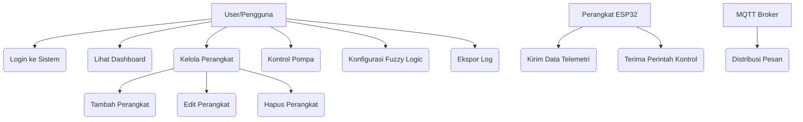
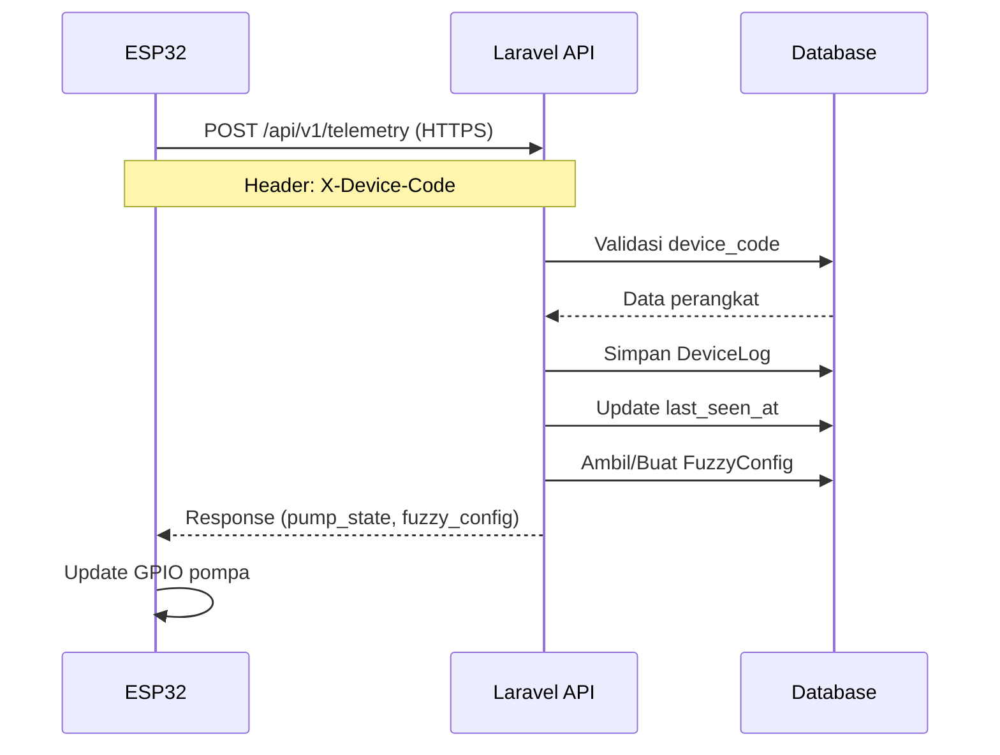
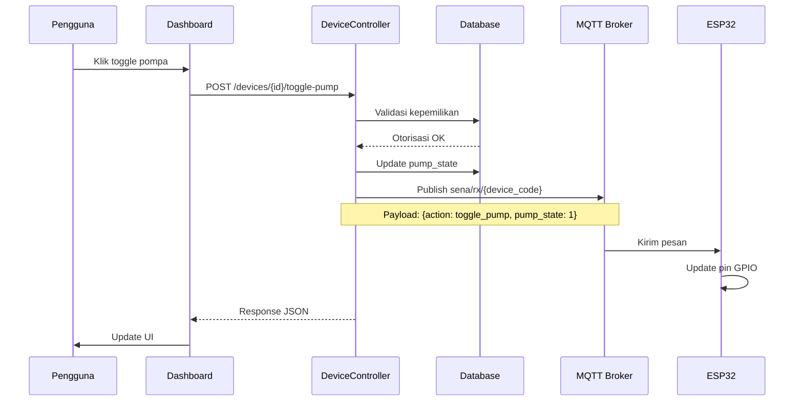
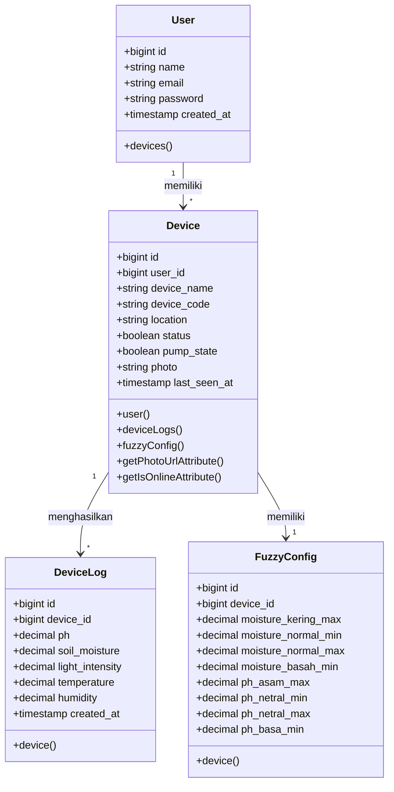
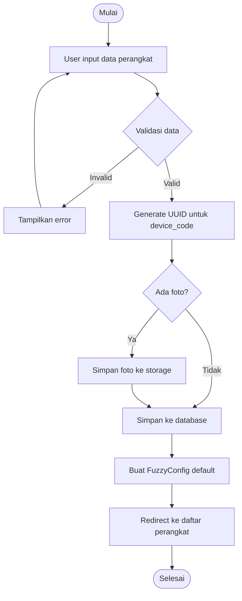

# DOKUMENTASI LENGKAP SISTEM IOT SMART FARMING

## Daftar Isi

1. [Ringkasan Eksekutif](#ringkasan-eksekutif)
2. [Arsitektur Sistem](#arsitektur-sistem)
3. [Diagram UML](#diagram-uml)
4. [Komunikasi MQTT](#komunikasi-mqtt)
5. [Firmware ESP32](#firmware-esp32)
6. [API Server Laravel](#api-server-laravel)
7. [Fitur Dashboard](#fitur-dashboard)
8. [Manajemen Perangkat](#manajemen-perangkat)
9. [Konfigurasi Fuzzy Logic](#konfigurasi-fuzzy-logic)
10. [Sistem Logging](#sistem-logging)
11. [Penjelasan Kode Controller](#penjelasan-kode-controller)
12. [Penjelasan Model Eloquent](#penjelasan-model-eloquent)
13. [Panduan Instalasi](#panduan-instalasi)
14. [Troubleshooting](#troubleshooting)
15. [Glosarium](#glosarium)

---

## Ringkasan Eksekutif

### Tentang Sistem

Sistem Smart Farming IoT adalah aplikasi berbasis web yang terintegrasi dengan perangkat ESP32 untuk monitoring dan kontrol pertanian secara real-time. Sistem ini menggunakan teknologi:

- **Backend**: Laravel 11 dengan PHP 8.2
- **Frontend**: Blade Templates dengan Alpine.js dan Tailwind CSS
- **Database**: SQLite (development) / MySQL (production)
- **IoT Device**: ESP32 dengan WiFi dan sensor
- **Protokol Komunikasi**: HTTPS dan MQTT
- **Autentikasi**: Laravel Sanctum

### Fitur Utama

1. **Monitoring Real-time**: Pemantauan data sensor (pH, kelembaban tanah, intensitas cahaya, suhu, kelembaban udara)
2. **Kontrol Pompa**: Kontrol manual pompa air melalui dashboard web
3. **Fuzzy Logic**: Sistem kontrol otomatis berbasis logika fuzzy
4. **Manajemen Perangkat**: CRUD perangkat IoT dengan foto dan lokasi
5. **Logging Historis**: Penyimpanan dan ekspor data telemetri
6. **Multi-user**: Setiap user dapat memiliki multiple devices

### Arsitektur Tingkat Tinggi

```
┌─────────────────┐         ┌──────────────────┐         ┌─────────────────┐
│  Perangkat ESP32│◄───────►│  Server Laravel  │◄───────►│  Web Dashboard  │
│   (Firmware)    │  HTTPS  │   (Backend API)  │  HTTP   │   (Frontend)    │
└─────────────────┘         └──────────────────┘         └─────────────────┘
        │                            │
        │                            │
        └────────────MQTT────────────┘
                     │
              ┌──────▼──────┐
              │ MQTT Broker │
              └─────────────┘
```


---

## Arsitektur Sistem

### Arsitektur 3-Tier

Sistem ini menggunakan arsitektur 3-tier yang terdiri dari:

#### 1. Layer Perangkat IoT (ESP32)
- Pengumpulan data sensor (pH, kelembaban tanah, cahaya, suhu, kelembaban)
- Manajemen konektivitas WiFi
- Komunikasi HTTPS API untuk transmisi telemetri
- Subscription MQTT untuk menerima perintah kontrol
- Kontrol aktuator (relay pompa)

#### 2. Layer Aplikasi (Laravel)
- REST API endpoints untuk komunikasi perangkat
- MQTT listener untuk pemrosesan telemetri real-time
- Persistensi database (SQLite/MySQL)
- Autentikasi dan otorisasi (Sanctum)
- Business logic dan manajemen konfigurasi fuzzy logic

#### 3. Layer Presentasi (Web Dashboard)
- Visualisasi telemetri real-time
- Interface manajemen perangkat
- UI konfigurasi fuzzy logic
- Chart data historis dan ekspor

### Pola Komunikasi

#### Komunikasi HTTPS (ESP32 → Laravel)
- **Endpoint**: `POST /api/v1/telemetry`
- **Protokol**: HTTPS dengan SSL/TLS
- **Autentikasi**: Custom header `X-Device-Code: {uuid}`
- **Frekuensi**: Setiap 5 detik (dapat dikonfigurasi)
- **Payload**: JSON dengan data sensor

#### Komunikasi MQTT (Bidirectional)
- **Broker**: HiveMQ (default) atau broker custom
- **Port**: 1883 (standard) atau 8883 (TLS)
- **Topic Telemetri**: `sena/tx/{device_code}` (Device → Server)
- **Topic Kontrol**: `sena/rx/{device_code}` (Server → Device)
- **QoS**: 0 (at most once delivery)


---

## Diagram UML

### Diagram Use Case



### Diagram Sequence - Alur Data Telemetri



### Diagram Sequence - Kontrol Pompa




### Diagram Class - Model Database



### Diagram Activity - Proses Registrasi Perangkat




---

## Komunikasi MQTT

### Konfigurasi Broker

**File**: `config/mqtt.php`

```php
return [
    'host' => env('MQTT_HOST', 'broker.hivemq.com'),
    'port' => env('MQTT_PORT', 1883),
    'client_id' => env('MQTT_CLIENT_ID', 'sena_backend_' . uniqid()),
    'username' => env('MQTT_USERNAME', ''),
    'password' => env('MQTT_PASSWORD', ''),
];
```

**Variabel Environment** (`.env`):
```env
MQTT_HOST=broker.hivemq.com
MQTT_PORT=1883
MQTT_CLIENT_ID=sena_backend_12345
MQTT_USERNAME=
MQTT_PASSWORD=
```

### Struktur Topic

#### 1. Topic Telemetri (Device → Server)
- **Pattern**: `sena/tx/{device_code}`
- **Contoh**: `sena/tx/550e8400-e29b-41d4-a716-446655440000`
- **QoS**: 0 (at most once)
- **Retained**: false
- **Deskripsi**: Perangkat mempublikasikan data sensor ke server

**Format Payload**:
```json
{
  "ph": 6.5,
  "soil_moisture": 65.0,
  "light_intensity": 850.0,
  "temperature": 26.5,
  "humidity": 72.0
}
```

#### 2. Topic Kontrol (Server → Device)
- **Pattern**: `sena/rx/{device_code}`
- **Contoh**: `sena/rx/550e8400-e29b-41d4-a716-446655440000`
- **QoS**: 0 (at most once)
- **Retained**: false
- **Deskripsi**: Server mengirim perintah kontrol ke perangkat

**Format Payload - Toggle Pompa**:
```json
{
  "action": "toggle_pump",
  "pump_state": 1
}
```

**Format Payload - Update Fuzzy Config**:
```json
{
  "action": "update_fuzzy",
  "moisture_kering_max": 30.0,
  "moisture_normal_min": 30.0,
  "moisture_normal_max": 70.0,
  "moisture_basah_min": 70.0,
  "ph_asam_max": 6.0,
  "ph_netral_min": 6.0,
  "ph_netral_max": 8.0,
  "ph_basa_min": 8.0
}
```


### MQTT Listener Command

**File**: `app/Console/Commands/MqttListener.php`

Command ini berjalan di background untuk mendengarkan pesan MQTT dari perangkat.

**Menjalankan Listener**:
```bash
php artisan mqtt:listen
```

**Cara Kerja**:
1. Koneksi ke MQTT broker menggunakan konfigurasi dari `config/mqtt.php`
2. Subscribe ke topic `sena/tx/+` (wildcard untuk semua device_code)
3. Ketika menerima pesan:
   - Parse JSON payload
   - Ekstrak device_code dari topic
   - Validasi perangkat di database
   - Simpan data telemetri ke tabel `device_logs`
   - Update `last_seen_at` pada tabel `devices`

**Error Handling**:
- Koneksi gagal: Log error dan coba reconnect
- JSON invalid: Skip pesan dan log warning
- Device tidak ditemukan: Skip pesan dan log warning
- Database error: Log error dan lanjutkan listening

### Setting Koneksi MQTT

**Keep-Alive Interval**: 60 detik
**Clean Session**: true
**Auto Reconnect**: Ya (otomatis reconnect jika koneksi terputus)
**Connection Timeout**: 30 detik

---

## Firmware ESP32

### Komponen Utama Firmware

#### 1. WiFi Manager
Mengelola koneksi WiFi perangkat ESP32.

```cpp
// Konfigurasi WiFi
const char* ssid = "NAMA_WIFI";
const char* password = "PASSWORD_WIFI";

// Fungsi koneksi WiFi
void connectWiFi() {
    WiFi.begin(ssid, password);
    while (WiFi.status() != WL_CONNECTED) {
        delay(500);
        Serial.print(".");
    }
    Serial.println("\nWiFi Connected!");
    Serial.print("IP Address: ");
    Serial.println(WiFi.localIP());
}
```

**Fitur**:
- Auto-reconnect jika koneksi terputus
- Monitoring status koneksi
- Tampilan IP address di Serial Monitor


#### 2. HTTPS Client
Mengirim data telemetri ke server Laravel via HTTPS.

```cpp
#include <WiFiClientSecure.h>
#include <HTTPClient.h>

WiFiClientSecure client;
HTTPClient http;

// Konfigurasi
const char* serverUrl = "https://domain.com/api/v1/telemetry";
const char* deviceCode = "550e8400-e29b-41d4-a716-446655440000";

void sendTelemetry() {
    client.setInsecure(); // Untuk testing, gunakan CA cert di production
    
    http.begin(client, serverUrl);
    http.addHeader("Content-Type", "application/json");
    http.addHeader("X-Device-Code", deviceCode);
    
    // Buat JSON payload
    String payload = createJsonPayload();
    
    int httpCode = http.POST(payload);
    
    if (httpCode > 0) {
        String response = http.getString();
        parseResponse(response);
    }
    
    http.end();
}
```

**Header yang Diperlukan**:
- `Content-Type: application/json`
- `X-Device-Code: {uuid}` (untuk autentikasi perangkat)

#### 3. JSON Serializer
Menggunakan library ArduinoJson untuk serialisasi data.

```cpp
#include <ArduinoJson.h>

String createJsonPayload() {
    StaticJsonDocument<200> doc;
    
    doc["ph"] = readPH();
    doc["soil_moisture"] = readSoilMoisture();
    doc["light_intensity"] = readLight();
    doc["temperature"] = readTemperature();
    doc["humidity"] = readHumidity();
    
    String output;
    serializeJson(doc, output);
    return output;
}
```

#### 4. Response Parser
Mem-parse response dari server untuk mendapatkan status pompa dan konfigurasi fuzzy.

```cpp
void parseResponse(String response) {
    StaticJsonDocument<512> doc;
    DeserializationError error = deserializeJson(doc, response);
    
    if (!error) {
        // Ambil status pompa
        bool pumpState = doc["device_controls"]["pump_state"];
        digitalWrite(pumpPin, pumpState ? HIGH : LOW);
        
        // Ambil konfigurasi fuzzy (opsional)
        if (doc.containsKey("fuzzy_config")) {
            // Update parameter fuzzy logic lokal
        }
    }
}
```


#### 5. Timing Controller
Menggunakan `millis()` untuk non-blocking delay.

```cpp
unsigned long lastTime = 0;
unsigned long timerDelay = 5000; // 5 detik

void loop() {
    if ((millis() - lastTime) > timerDelay) {
        sendTelemetry();
        lastTime = millis();
    }
    
    // Kode lain bisa berjalan di sini tanpa blocking
}
```

**Keuntungan Non-blocking**:
- Loop tetap responsif
- Mencegah watchdog timer reset
- Memungkinkan operasi concurrent

#### 6. Sensor Simulator (untuk Testing)
Menghasilkan data sensor random untuk testing tanpa hardware sensor.

```cpp
float readPH() {
    return random(50, 70) / 10.0; // 5.0 - 7.0
}

float readSoilMoisture() {
    return random(40, 90); // 40% - 90%
}

float readLight() {
    return random(300, 1200); // 300 - 1200 lux
}

float readTemperature() {
    return random(230, 270) / 10.0; // 23.0 - 27.0 °C
}

float readHumidity() {
    return random(50, 80); // 50% - 80%
}
```

**Catatan**: Di production, ganti dengan pembacaan sensor sebenarnya.

### Konfigurasi Pin ESP32

```cpp
// Pin Definitions
const int pumpPin = 2;        // GPIO2 untuk relay pompa
const int phSensorPin = 34;   // GPIO34 untuk sensor pH (ADC)
const int moisturePin = 35;   // GPIO35 untuk sensor kelembaban tanah
const int lightPin = 32;      // GPIO32 untuk sensor cahaya
// DHT22 untuk suhu dan kelembaban udara
const int dhtPin = 4;         // GPIO4 untuk DHT22

void setup() {
    pinMode(pumpPin, OUTPUT);
    digitalWrite(pumpPin, LOW); // Pompa off saat startup
}
```


---

## API Server Laravel

### Endpoint API

#### 1. POST /api/v1/telemetry
Menerima data telemetri dari perangkat ESP32.

**Request**:
```http
POST /api/v1/telemetry HTTP/1.1
Host: domain.com
Content-Type: application/json
X-Device-Code: 550e8400-e29b-41d4-a716-446655440000

{
  "ph": 6.5,
  "soil_moisture": 65.0,
  "light_intensity": 850.0,
  "temperature": 26.5,
  "humidity": 72.0
}
```

**Response Success (201)**:
```json
{
  "status": "success",
  "message": "Telemetry data saved correctly",
  "data": {
    "id": 123,
    "device_id": 1,
    "ph": 6.5,
    "soil_moisture": 65.0,
    "light_intensity": 850.0,
    "temperature": 26.5,
    "humidity": 72.0,
    "created_at": "2024-01-15T10:30:00.000000Z"
  },
  "device_controls": {
    "pump_state": true
  },
  "fuzzy_config": {
    "moisture_kering_max": 30.0,
    "moisture_normal_min": 30.0,
    "moisture_normal_max": 70.0,
    "moisture_basah_min": 70.0,
    "ph_asam_max": 6.0,
    "ph_netral_min": 6.0,
    "ph_netral_max": 8.0,
    "ph_basa_min": 8.0
  }
}
```

**Response Error (401)**:
```json
{
  "status": "error",
  "message": "Unauthorized: Device Code missing"
}
```

**Response Error (403)**:
```json
{
  "status": "error",
  "message": "Unauthorized: Invalid or inactive device"
}
```

**Response Error (422)**:
```json
{
  "message": "The given data was invalid.",
  "errors": {
    "ph": ["The ph must be between 0 and 14."],
    "soil_moisture": ["The soil moisture must be between 0 and 100."]
  }
}
```


### Validasi Request

**File**: `app/Http/Controllers/Api/TelemetryController.php`

```php
$validated = $request->validate([
    'ph' => 'nullable|numeric|between:0,14',
    'soil_moisture' => 'nullable|numeric|between:0,100',
    'light_intensity' => 'nullable|numeric|min:0',
    'temperature' => 'nullable|numeric|between:-50,100',
    'humidity' => 'nullable|numeric|between:0,100',
]);
```

**Aturan Validasi**:
- `ph`: Opsional, numerik, rentang 0-14
- `soil_moisture`: Opsional, numerik, rentang 0-100%
- `light_intensity`: Opsional, numerik, minimal 0
- `temperature`: Opsional, numerik, rentang -50 hingga 100°C
- `humidity`: Opsional, numerik, rentang 0-100%

### Autentikasi Perangkat

Sistem menggunakan custom header `X-Device-Code` untuk autentikasi perangkat.

**Proses Autentikasi**:
1. Ekstrak `X-Device-Code` dari header request
2. Cari perangkat di database berdasarkan `device_code`
3. Validasi status perangkat (harus aktif)
4. Jika valid, lanjutkan proses
5. Jika tidak valid, return error 403

```php
$deviceCode = $request->header('X-Device-Code');

if (!$deviceCode) {
    return response()->json([
        'status' => 'error',
        'message' => 'Unauthorized: Device Code missing'
    ], 401);
}

$device = Device::where('device_code', $deviceCode)
                ->where('status', true)
                ->first();

if (!$device) {
    return response()->json([
        'status' => 'error',
        'message' => 'Unauthorized: Invalid or inactive device'
    ], 403);
}
```

### Database Schema

#### Tabel: users
```sql
CREATE TABLE users (
    id BIGINT PRIMARY KEY AUTO_INCREMENT,
    name VARCHAR(255) NOT NULL,
    email VARCHAR(255) UNIQUE NOT NULL,
    email_verified_at TIMESTAMP NULL,
    password VARCHAR(255) NOT NULL,
    remember_token VARCHAR(100) NULL,
    created_at TIMESTAMP DEFAULT CURRENT_TIMESTAMP,
    updated_at TIMESTAMP DEFAULT CURRENT_TIMESTAMP ON UPDATE CURRENT_TIMESTAMP
);
```


#### Tabel: devices
```sql
CREATE TABLE devices (
    id BIGINT PRIMARY KEY AUTO_INCREMENT,
    user_id BIGINT NOT NULL,
    device_name VARCHAR(255) NOT NULL,
    device_code VARCHAR(255) UNIQUE NOT NULL,
    location VARCHAR(255) NULL,
    status BOOLEAN DEFAULT TRUE,
    pump_state BOOLEAN DEFAULT FALSE,
    photo VARCHAR(255) NULL,
    last_seen_at TIMESTAMP NULL,
    created_at TIMESTAMP DEFAULT CURRENT_TIMESTAMP,
    updated_at TIMESTAMP DEFAULT CURRENT_TIMESTAMP ON UPDATE CURRENT_TIMESTAMP,
    FOREIGN KEY (user_id) REFERENCES users(id) ON DELETE CASCADE
);
```

**Kolom Penting**:
- `device_code`: UUID unik untuk autentikasi perangkat
- `status`: Status aktif/nonaktif perangkat
- `pump_state`: Status pompa (on/off)
- `last_seen_at`: Timestamp terakhir perangkat mengirim data

#### Tabel: device_logs
```sql
CREATE TABLE device_logs (
    id BIGINT PRIMARY KEY AUTO_INCREMENT,
    device_id BIGINT NOT NULL,
    ph DECIMAL(4,2) NULL,
    soil_moisture DECIMAL(5,2) NULL,
    light_intensity DECIMAL(8,2) NULL,
    temperature DECIMAL(5,2) NULL,
    humidity DECIMAL(5,2) NULL,
    created_at TIMESTAMP DEFAULT CURRENT_TIMESTAMP,
    updated_at TIMESTAMP DEFAULT CURRENT_TIMESTAMP ON UPDATE CURRENT_TIMESTAMP,
    FOREIGN KEY (device_id) REFERENCES devices(id) ON DELETE CASCADE
);
```

**Indeks untuk Performa**:
```sql
CREATE INDEX idx_device_logs_device_id ON device_logs(device_id);
CREATE INDEX idx_device_logs_created_at ON device_logs(created_at);
```

#### Tabel: fuzzy_configs
```sql
CREATE TABLE fuzzy_configs (
    id BIGINT PRIMARY KEY AUTO_INCREMENT,
    device_id BIGINT UNIQUE NOT NULL,
    moisture_kering_max DECIMAL(5,2) DEFAULT 30.00,
    moisture_normal_min DECIMAL(5,2) DEFAULT 30.00,
    moisture_normal_max DECIMAL(5,2) DEFAULT 70.00,
    moisture_basah_min DECIMAL(5,2) DEFAULT 70.00,
    ph_asam_max DECIMAL(4,2) DEFAULT 6.00,
    ph_netral_min DECIMAL(4,2) DEFAULT 6.00,
    ph_netral_max DECIMAL(4,2) DEFAULT 8.00,
    ph_basa_min DECIMAL(4,2) DEFAULT 8.00,
    created_at TIMESTAMP DEFAULT CURRENT_TIMESTAMP,
    updated_at TIMESTAMP DEFAULT CURRENT_TIMESTAMP ON UPDATE CURRENT_TIMESTAMP,
    FOREIGN KEY (device_id) REFERENCES devices(id) ON DELETE CASCADE
);
```


---

## Fitur Dashboard

### Halaman Dashboard Utama

**Route**: `GET /dashboard`
**Controller**: `DashboardController@index`
**Middleware**: `auth`, `verified`

#### Fitur Utama:
1. **Pemilihan Perangkat**: Dropdown untuk memilih perangkat yang akan dimonitor
2. **Data Real-time**: Menampilkan data sensor terbaru
3. **Status Online/Offline**: Indikator status koneksi perangkat
4. **Kontrol Pompa**: Toggle button untuk mengontrol pompa
5. **Chart Historis**: Grafik data sensor 24 jam terakhir
6. **Auto-refresh**: Data diperbarui otomatis setiap 5 detik

### Komponen Dashboard

#### 1. Card Informasi Perangkat
```html
<div class="device-info">
    <h3>{{ $device->device_name }}</h3>
    <p>Lokasi: {{ $device->location }}</p>
    <span class="status {{ $device->is_online ? 'online' : 'offline' }}">
        {{ $device->is_online ? 'Online' : 'Offline' }}
    </span>
    <p>Terakhir terlihat: {{ $device->last_seen_at->diffForHumans() }}</p>
</div>
```

#### 2. Card Data Sensor
Menampilkan data sensor terbaru dalam card terpisah:

- **pH Tanah**: Nilai pH dengan indikator warna (asam/netral/basa)
- **Kelembaban Tanah**: Persentase dengan progress bar
- **Intensitas Cahaya**: Nilai lux dengan ikon
- **Suhu**: Derajat Celsius dengan ikon termometer
- **Kelembaban Udara**: Persentase dengan ikon

#### 3. Kontrol Pompa
```html
<div class="pump-control">
    <label>Kontrol Pompa</label>
    <button onclick="togglePump({{ $device->id }})" 
            class="btn {{ $device->pump_state ? 'btn-danger' : 'btn-success' }}">
        {{ $device->pump_state ? 'Matikan Pompa' : 'Nyalakan Pompa' }}
    </button>
</div>
```

**JavaScript untuk Toggle Pompa**:
```javascript
function togglePump(deviceId) {
    fetch(`/devices/${deviceId}/toggle-pump`, {
        method: 'POST',
        headers: {
            'Content-Type': 'application/json',
            'X-CSRF-TOKEN': document.querySelector('meta[name="csrf-token"]').content
        }
    })
    .then(response => response.json())
    .then(data => {
        if (data.success) {
            location.reload();
        }
    });
}
```


#### 4. Chart Data Historis
Menggunakan Chart.js untuk visualisasi data.

```javascript
// Ambil data dari API
fetch('/dashboard/data?device_id=' + deviceId)
    .then(response => response.json())
    .then(data => {
        updateCharts(data);
    });

function updateCharts(data) {
    // Chart Kelembaban Tanah
    const moistureChart = new Chart(ctx, {
        type: 'line',
        data: {
            labels: data.timestamps,
            datasets: [{
                label: 'Kelembaban Tanah (%)',
                data: data.soil_moisture,
                borderColor: 'rgb(75, 192, 192)',
                tension: 0.1
            }]
        }
    });
    
    // Chart lainnya...
}
```

### Auto-refresh Data

**Polling setiap 5 detik**:
```javascript
setInterval(() => {
    fetch('/dashboard/data?device_id=' + deviceId)
        .then(response => response.json())
        .then(data => {
            updateSensorValues(data.latest);
            updateCharts(data.chart_data);
        });
}, 5000);
```

### Deteksi Status Online/Offline

Perangkat dianggap online jika `last_seen_at` kurang dari 2 menit yang lalu.

**Model Accessor** (`app/Models/Device.php`):
```php
public function getIsOnlineAttribute()
{
    if (!$this->last_seen_at) {
        return false;
    }
    
    return $this->last_seen_at->diffInMinutes(now()) < 2;
}
```

---

## Manajemen Perangkat

### Daftar Perangkat

**Route**: `GET /devices`
**Controller**: `DeviceController@index`

Menampilkan semua perangkat milik user yang sedang login dengan fitur:
- Pagination (10 perangkat per halaman)
- Search berdasarkan nama atau lokasi
- Filter berdasarkan status (aktif/nonaktif)
- Tombol aksi (Edit, Hapus, Konfigurasi Fuzzy)


### Tambah Perangkat Baru

**Route**: `POST /devices`
**Controller**: `DeviceController@store`

#### Form Input:
- **Nama Perangkat** (required): Nama identifikasi perangkat
- **Lokasi** (optional): Lokasi penempatan perangkat
- **Foto** (optional): Foto perangkat (max 2MB, format: jpg, png)
- **Status** (default: aktif): Checkbox untuk mengaktifkan/menonaktifkan

#### Proses:
1. Validasi input
2. Generate UUID untuk `device_code`
3. Upload foto ke `storage/app/public/devices` (jika ada)
4. Simpan data perangkat ke database
5. Buat konfigurasi fuzzy default
6. Redirect ke halaman daftar perangkat

**Kode Controller**:
```php
public function store(Request $request)
{
    $validated = $request->validate([
        'device_name' => 'required|string|max:255',
        'location' => 'nullable|string|max:255',
        'photo' => 'nullable|image|max:2048',
        'status' => 'boolean',
    ]);
    
    // Generate UUID
    $validated['device_code'] = Str::uuid()->toString();
    $validated['user_id'] = auth()->id();
    
    // Upload foto
    if ($request->hasFile('photo')) {
        $validated['photo'] = $request->file('photo')
            ->store('devices', 'public');
    }
    
    // Simpan perangkat
    $device = Device::create($validated);
    
    // Buat fuzzy config default
    FuzzyConfig::create(['device_id' => $device->id]);
    
    return redirect()->route('devices.index')
        ->with('success', 'Perangkat berhasil ditambahkan');
}
```

### Edit Perangkat

**Route**: `PUT /devices/{device}`
**Controller**: `DeviceController@update`

Memungkinkan user untuk mengubah:
- Nama perangkat
- Lokasi
- Foto (upload baru atau hapus yang lama)
- Status aktif/nonaktif

**Validasi Kepemilikan**:
```php
public function update(Request $request, Device $device)
{
    // Pastikan user adalah pemilik perangkat
    if ($device->user_id !== auth()->id()) {
        abort(403, 'Unauthorized action.');
    }
    
    // Proses update...
}
```


### Hapus Perangkat

**Route**: `DELETE /devices/{device}`
**Controller**: `DeviceController@destroy`

#### Proses:
1. Validasi kepemilikan perangkat
2. Hapus foto dari storage (jika ada)
3. Hapus perangkat dari database (cascade delete untuk logs dan fuzzy config)
4. Redirect dengan pesan sukses

**Kode Controller**:
```php
public function destroy(Device $device)
{
    // Validasi kepemilikan
    if ($device->user_id !== auth()->id()) {
        abort(403, 'Unauthorized action.');
    }
    
    // Hapus foto
    if ($device->photo) {
        Storage::disk('public')->delete($device->photo);
    }
    
    // Hapus perangkat (cascade delete untuk relasi)
    $device->delete();
    
    return redirect()->route('devices.index')
        ->with('success', 'Perangkat berhasil dihapus');
}
```

### Toggle Pompa

**Route**: `POST /devices/{device}/toggle-pump`
**Controller**: `DeviceController@togglePump`

#### Proses:
1. Validasi kepemilikan perangkat
2. Toggle status `pump_state` (true ↔ false)
3. Publish pesan MQTT ke topic `sena/rx/{device_code}`
4. Return response JSON

**Kode Controller**:
```php
public function togglePump(Device $device)
{
    // Validasi kepemilikan
    if ($device->user_id !== auth()->id()) {
        return response()->json(['success' => false], 403);
    }
    
    // Toggle pump state
    $device->pump_state = !$device->pump_state;
    $device->save();
    
    // Publish MQTT message
    $mqtt = new MqttClient(/* config */);
    $mqtt->connect();
    $mqtt->publish(
        "sena/rx/{$device->device_code}",
        json_encode([
            'action' => 'toggle_pump',
            'pump_state' => $device->pump_state ? 1 : 0
        ])
    );
    $mqtt->disconnect();
    
    return response()->json([
        'success' => true,
        'pump_state' => $device->pump_state
    ]);
}
```


---

## Konfigurasi Fuzzy Logic

### Konsep Fuzzy Logic

Fuzzy logic digunakan untuk mengotomatisasi kontrol pompa berdasarkan kondisi sensor. Sistem menggunakan dua parameter utama:

1. **Kelembaban Tanah** dengan 3 kategori fuzzy:
   - **Kering**: 0% - 30%
   - **Normal**: 30% - 70%
   - **Basah**: 70% - 100%

2. **pH Tanah** dengan 3 kategori fuzzy:
   - **Asam**: 0 - 6.0
   - **Netral**: 6.0 - 8.0
   - **Basa**: 8.0 - 14.0

### Halaman Konfigurasi

**Route**: `GET /devices/{device}/fuzzy`
**Controller**: `FuzzyConfigController@edit`

#### Form Konfigurasi:

**Parameter Kelembaban Tanah**:
- Kering Max: Batas maksimal kategori kering (default: 30%)
- Normal Min: Batas minimal kategori normal (default: 30%)
- Normal Max: Batas maksimal kategori normal (default: 70%)
- Basah Min: Batas minimal kategori basah (default: 70%)

**Parameter pH Tanah**:
- Asam Max: Batas maksimal kategori asam (default: 6.0)
- Netral Min: Batas minimal kategori netral (default: 6.0)
- Netral Max: Batas maksimal kategori netral (default: 8.0)
- Basa Min: Batas minimal kategori basa (default: 8.0)

### Update Konfigurasi

**Route**: `PUT /devices/{device}/fuzzy`
**Controller**: `FuzzyConfigController@update`

#### Proses:
1. Validasi kepemilikan perangkat
2. Validasi nilai threshold (harus konsisten)
3. Update atau buat konfigurasi fuzzy
4. Publish konfigurasi ke perangkat via MQTT
5. Redirect dengan pesan sukses


**Kode Controller**:
```php
public function update(Request $request, Device $device)
{
    // Validasi kepemilikan
    if ($device->user_id !== auth()->id()) {
        abort(403, 'Unauthorized action.');
    }
    
    // Validasi input
    $validated = $request->validate([
        'moisture_kering_max' => 'required|numeric|min:0|max:100',
        'moisture_normal_min' => 'required|numeric|min:0|max:100',
        'moisture_normal_max' => 'required|numeric|min:0|max:100',
        'moisture_basah_min' => 'required|numeric|min:0|max:100',
        'ph_asam_max' => 'required|numeric|min:0|max:14',
        'ph_netral_min' => 'required|numeric|min:0|max:14',
        'ph_netral_max' => 'required|numeric|min:0|max:14',
        'ph_basa_min' => 'required|numeric|min:0|max:14',
    ]);
    
    // Update atau buat konfigurasi
    $fuzzyConfig = FuzzyConfig::updateOrCreate(
        ['device_id' => $device->id],
        $validated
    );
    
    // Publish ke MQTT
    $mqtt = new MqttClient(/* config */);
    $mqtt->connect();
    $mqtt->publish(
        "sena/rx/{$device->device_code}",
        json_encode([
            'action' => 'update_fuzzy',
            ...$validated
        ])
    );
    $mqtt->disconnect();
    
    return redirect()->route('devices.fuzzy', $device)
        ->with('success', 'Konfigurasi fuzzy berhasil diperbarui');
}
```

### Aturan Fuzzy Logic

**Aturan Dasar**:
1. **IF** kelembaban = Kering **AND** pH = Netral **THEN** Pompa = ON
2. **IF** kelembaban = Normal **AND** pH = Netral **THEN** Pompa = OFF
3. **IF** kelembaban = Basah **THEN** Pompa = OFF
4. **IF** pH = Asam **OR** pH = Basa **THEN** Pompa = OFF (perlu penyesuaian pH dulu)

**Implementasi di ESP32**:
```cpp
bool shouldPumpOn(float moisture, float ph) {
    // Cek kategori kelembaban
    bool isDry = (moisture <= moisture_kering_max);
    bool isNormal = (moisture >= moisture_normal_min && 
                     moisture <= moisture_normal_max);
    bool isWet = (moisture >= moisture_basah_min);
    
    // Cek kategori pH
    bool isAcidic = (ph <= ph_asam_max);
    bool isNeutral = (ph >= ph_netral_min && ph <= ph_netral_max);
    bool isBasic = (ph >= ph_basa_min);
    
    // Terapkan aturan fuzzy
    if (isDry && isNeutral) {
        return true; // Pompa ON
    }
    
    return false; // Pompa OFF
}
```


---

## Sistem Logging

### Penyimpanan Data Telemetri

Setiap data telemetri yang diterima dari perangkat disimpan ke tabel `device_logs` untuk keperluan:
- Analisis historis
- Visualisasi chart
- Ekspor data
- Audit trail

**Model**: `app/Models/DeviceLog.php`

```php
class DeviceLog extends Model
{
    protected $fillable = [
        'device_id',
        'ph',
        'soil_moisture',
        'light_intensity',
        'temperature',
        'humidity',
    ];
    
    protected $casts = [
        'ph' => 'float',
        'soil_moisture' => 'float',
        'light_intensity' => 'float',
        'temperature' => 'float',
        'humidity' => 'float',
        'created_at' => 'datetime',
    ];
    
    public function device()
    {
        return $this->belongsTo(Device::class);
    }
}
```

### Halaman Riwayat Log

**Route**: `GET /logs`
**Controller**: `SystemLogController@index`

#### Fitur:
- Tampilkan semua log dari perangkat user
- Filter berdasarkan perangkat
- Filter berdasarkan rentang tanggal
- Pagination (50 record per halaman)
- Sorting berdasarkan waktu (terbaru dulu)

**Query Contoh**:
```php
$logs = DeviceLog::whereHas('device', function($query) {
        $query->where('user_id', auth()->id());
    })
    ->when($request->device_id, function($query, $deviceId) {
        $query->where('device_id', $deviceId);
    })
    ->when($request->date_from, function($query, $dateFrom) {
        $query->whereDate('created_at', '>=', $dateFrom);
    })
    ->when($request->date_to, function($query, $dateTo) {
        $query->whereDate('created_at', '<=', $dateTo);
    })
    ->orderBy('created_at', 'desc')
    ->paginate(50);
```


### Ekspor Data

**Route**: `GET /logs/export`
**Controller**: `SystemLogController@export`

#### Format Ekspor:
- **CSV**: Comma-separated values untuk Excel/spreadsheet
- **JSON**: Format JSON untuk integrasi dengan sistem lain
- **PDF**: Laporan PDF dengan chart (opsional)

**Kode Ekspor CSV**:
```php
public function export(Request $request)
{
    $logs = DeviceLog::whereHas('device', function($query) {
            $query->where('user_id', auth()->id());
        })
        ->when($request->device_id, function($query, $deviceId) {
            $query->where('device_id', $deviceId);
        })
        ->when($request->date_from, function($query, $dateFrom) {
            $query->whereDate('created_at', '>=', $dateFrom);
        })
        ->when($request->date_to, function($query, $dateTo) {
            $query->whereDate('created_at', '<=', $dateTo);
        })
        ->with('device')
        ->orderBy('created_at', 'desc')
        ->get();
    
    $filename = 'telemetry_logs_' . date('Y-m-d_His') . '.csv';
    
    $headers = [
        'Content-Type' => 'text/csv',
        'Content-Disposition' => "attachment; filename=\"$filename\"",
    ];
    
    $callback = function() use ($logs) {
        $file = fopen('php://output', 'w');
        
        // Header CSV
        fputcsv($file, [
            'Waktu', 'Perangkat', 'pH', 'Kelembaban Tanah (%)',
            'Intensitas Cahaya', 'Suhu (°C)', 'Kelembaban Udara (%)'
        ]);
        
        // Data
        foreach ($logs as $log) {
            fputcsv($file, [
                $log->created_at->format('Y-m-d H:i:s'),
                $log->device->device_name,
                $log->ph,
                $log->soil_moisture,
                $log->light_intensity,
                $log->temperature,
                $log->humidity,
            ]);
        }
        
        fclose($file);
    };
    
    return response()->stream($callback, 200, $headers);
}
```

### Kebijakan Retensi Data

**Rekomendasi**:
- **Data Real-time**: Simpan semua data
- **Data > 1 bulan**: Agregasi per jam (rata-rata)
- **Data > 6 bulan**: Agregasi per hari (rata-rata)
- **Data > 1 tahun**: Arsipkan atau hapus

**Implementasi dengan Scheduled Task**:
```php
// app/Console/Kernel.php
protected function schedule(Schedule $schedule)
{
    // Agregasi data lama setiap hari jam 2 pagi
    $schedule->call(function () {
        // Agregasi data > 1 bulan
        // Implementasi agregasi...
    })->dailyAt('02:00');
}
```


---

## Penjelasan Kode Controller

### DeviceController

**File**: `app/Http/Controllers/DeviceController.php`

#### Method: index()
**Fungsi**: Menampilkan daftar perangkat milik user

```php
public function index()
{
    // Ambil semua perangkat milik user yang sedang login
    // dengan pagination 10 item per halaman
    $devices = Device::where('user_id', auth()->id())
        ->orderBy('created_at', 'desc')
        ->paginate(10);
    
    return view('devices.index', compact('devices'));
}
```

**Penjelasan**:
1. Query perangkat berdasarkan `user_id` yang sedang login
2. Urutkan berdasarkan tanggal pembuatan (terbaru dulu)
3. Pagination untuk performa (10 item per halaman)
4. Return view dengan data perangkat

#### Method: store()
**Fungsi**: Menyimpan perangkat baru

**Alur Logika**:
1. **Validasi Input**: Validasi data dari form
2. **Generate UUID**: Buat device_code unik menggunakan `Str::uuid()`
3. **Upload Foto**: Jika ada foto, simpan ke `storage/app/public/devices`
4. **Simpan Database**: Insert data ke tabel `devices`
5. **Buat Fuzzy Config**: Buat konfigurasi fuzzy default
6. **Redirect**: Kembali ke halaman daftar dengan pesan sukses

**Error Handling**:
- Validasi gagal: Return ke form dengan error message
- Upload foto gagal: Log error dan lanjutkan tanpa foto
- Database error: Rollback dan tampilkan error

#### Method: togglePump()
**Fungsi**: Toggle status pompa dan kirim perintah ke perangkat

**Alur Logika**:
1. **Validasi Kepemilikan**: Pastikan user adalah pemilik perangkat
2. **Toggle State**: Ubah `pump_state` dari true ke false atau sebaliknya
3. **Simpan ke Database**: Update status di database
4. **Publish MQTT**: Kirim perintah ke perangkat via MQTT
5. **Return JSON**: Response sukses/gagal dalam format JSON

**Payload MQTT**:
```json
{
  "action": "toggle_pump",
  "pump_state": 1  // 1 = ON, 0 = OFF
}
```

